

# Metaanalyse experimenteller und klinischer Ergebnisse bei keramischen und metallischen Implantaten nach Oberflächenmodifikationen

**Inaugural-Dissertation**
zur Erlangung des Grades eines Doktors der Zahnmedizin
des Fachbereichs Medizin
der Justus-Liebig-Universität Gießen

vorgelegt von

**[Name]**

aus [Geburtsort]

Gießen 2026

---

Aus dem Fachbereich Medizin der Justus-Liebig-Universität Gießen

Gutachter: ______________________

Gutachter: ______________________

Tag der Disputation: ______________________

## Inhaltsverzeichnis

**Abkürzungsverzeichnis**

**1 Einleitung**
1.1 Problemstellung
1.2 Zielsetzung
1.3 Fragestellungen und Hypothesen

**2 Literaturübersicht**
2.1 Osseointegration als biologisches Grundprinzip
2.2 Werkstoffe enossaler Dentalimplantate
2.3 Systematik der Oberflächenmodifikationen
2.4 Zielgrößen der Osseointegrationsforschung
2.5 Bisherige Evidenzsynthesen und Forschungslücke

**3 Material und Methoden**
3.1 Studiendesign, Protokoll und Berichterstattung
3.2 Fragestellung nach dem PICO-Schema
3.3 Ein- und Ausschlusskriterien
3.4 Informationsquellen und Suchstrategie
3.5 Studienselektion
3.6 Datenextraktion
3.7 Bewertung des Verzerrungsrisikos
3.8 Statistische Auswertung
3.9 Bewertung der Evidenzsicherheit
3.10 Software, Reproduzierbarkeit und Datenverfügbarkeit
3.11 Abweichungen vom Protokoll

**4 Ergebnisse**
4.1 Ergebnis der Studienselektion
4.2 Charakteristika der eingeschlossenen Studien
4.3 Verzerrungsrisiko
4.4 Analyse A1 – Knochen-Implantat-Kontakt: Keramik versus Titan
4.5 Analyse B1 – Knochen-Implantat-Kontakt: Oberflächenmodifikation
4.6 Analyse B2 – Biomechanische Verankerung
4.7 Analyse C1 – Klinischer Implantatverlust
4.8 Analyse C2 – Marginaler Knochenverlust
4.9 Analyse C3 – Überleben keramischer Implantate
4.10 Publikationsbias und Kleinstudieneffekte
4.11 Sensitivitätsanalysen
4.12 Evidenzsicherheit nach GRADE

**5 Diskussion**
5.1 Zusammenfassung der Hauptbefunde
5.2 Einordnung in die vorliegende Literatur
5.3 Die translationale Lücke zwischen Experiment und Klinik
5.4 Heterogenität und ihre Ursachen
5.5 Methodische Stärken
5.6 Limitationen
5.7 Klinische Schlussfolgerungen
5.8 Forschungsbedarf

**6 Zusammenfassung**
**7 Summary**
**8 Literaturverzeichnis** (separates Dokument)
**9 Anhang**
**10 Erklärungen**

## Abkürzungsverzeichnis

| Abkürzung | Bedeutung |
|---|---|
| Al₂O₃ | Aluminiumoxid |
| ATZ | *alumina-toughened zirconia*, aluminiumoxidverstärktes Zirkonoxid |
| BA | *bone area*, Knochenflächenanteil |
| BAFO | *bone area fraction occupancy* |
| BIC | *bone-to-implant contact*, Knochen-Implantat-Kontakt |
| BV/TV | *bone volume / total volume* |
| cpTi | *commercially pure titanium*, Reintitan |
| Ce-TZP | ceroxidstabilisiertes tetragonales Zirkonoxidpolykristall |
| DAE | *dual acid-etched*, doppelt säuregeätzt |
| GRADE | *Grading of Recommendations, Assessment, Development and Evaluation* |
| HA | Hydroxylapatit |
| HKSJ | Hartung-Knapp-Sidik-Jonkman |
| I² | Inkonsistenzmaß nach Higgins und Thompson |
| IQR | Interquartilsabstand |
| ISQ | *implant stability quotient* |
| KI | Konfidenzintervall |
| LTD | *low temperature degradation*, Niedertemperaturdegradation |
| MBL | *marginal bone loss*, marginaler Knochenverlust |
| MD | Mittelwertdifferenz |
| PICO | *Population, Intervention, Comparison, Outcome* |
| PRISMA | *Preferred Reporting Items for Systematic Reviews and Meta-Analyses* |
| PVD | *physical vapour deposition* |
| RBM | *resorbable blast media* |
| REML | *restricted maximum likelihood* |
| RoB | *risk of bias*, Verzerrungsrisiko |
| ROBINS-I | *Risk Of Bias In Non-randomised Studies of Interventions* |
| RR | *risk ratio*, relatives Risiko |
| SD | Standardabweichung |
| SEM | Standardfehler des Mittelwerts |
| SLA | *sandblasted, large-grit, acid-etched* |
| SMD | standardisierte Mittelwertdifferenz |
| SYRCLE | *Systematic Review Centre for Laboratory animal Experimentation* |
| τ² | Varianz des zufälligen Effekts zwischen Studien |
| TiZr | Titan-Zirkonium-Legierung |
| TPS | Titanplasmabeschichtung (*titanium plasma-sprayed*) |
| Y-TZP | yttriumstabilisiertes tetragonales Zirkonoxidpolykristall |
| ZrO₂ | Zirkonoxid (Zirkoniumdioxid) |

# 1 Einleitung

## 1.1 Problemstellung

Die Rehabilitation von Zahnverlust durch enossale Implantate zählt zu den am besten
dokumentierten Therapieverfahren der Zahnmedizin. Ihre biologische Grundlage ist die
Osseointegration – der von Brånemark und Mitarbeitern beschriebene direkte
funktionelle und strukturelle Verbund zwischen lasttragendem Knochen und
Implantatoberfläche (Brånemark et al. 1977; Albrektsson et al. 1981). Von den sechs
klassischen Determinanten der Osseointegration – Werkstoff, Implantatdesign,
Oberflächenbeschaffenheit, Implantatlager, Operationstechnik und Belastungsprotokoll
(Albrektsson et al. 1981) – ist die Oberflächenbeschaffenheit diejenige, die der
Hersteller am unmittelbarsten und am gezieltesten beeinflussen kann. Sie ist damit
zugleich das am intensivsten beforschte Entwicklungsfeld der Implantologie.

Der Übergang von der maschinierten („gedrehten") zur mikrorauen Oberfläche in den
1990er Jahren gilt heute als Paradigmenwechsel. Buser und Mitarbeiter zeigten im
Minipigmodell erstmals systematisch, dass sandgestrahlte und säuregeätzte Oberflächen
einen deutlich höheren Knochen-Implantat-Kontakt erzielen als maschinierte
(Buser et al. 1991); die klinische Konsequenz – die Verkürzung der Einheilzeit von
mehreren Monaten auf sechs Wochen – wurde wenig später in prospektiven Studien
bestätigt (Cochran et al. 2002). Seither hat sich das Feld weiter ausdifferenziert:
Neben rein topographischen (subtraktiven) Verfahren stehen chemische Modifikationen
der Oberflächenenergie und Benetzbarkeit (Buser et al. 2004;
Wennerberg et al. 2011), additive Beschichtungen mit Kalziumphosphaten oder
Biomolekülen (Junker et al. 2009), physikalische Verfahren wie Laserstrukturierung
und Photofunktionalisierung sowie nanoskalige Hierarchisierungen der Oberfläche
(Coelho et al. 2015; Smeets et al. 2016).

Parallel zu dieser Entwicklung hat sich die Werkstofffrage neu gestellt. Titan und
seine Legierungen sind seit fünf Jahrzehnten der klinische Referenzwerkstoff. Ihre
Grenzen liegen weniger in der biologischen Verträglichkeit als in ästhetischen
Gesichtspunkten – der grau durchscheinende Implantathals bei dünnem gingivalem
Biotyp –, in der Freisetzung von Titanpartikeln und -ionen sowie im wachsenden
Patientenwunsch nach metallfreier Versorgung (Cionca et al. 2017; Hanawa 2020).
Yttriumstabilisiertes tetragonales Zirkonoxidpolykristall (Y-TZP) und dessen
Weiterentwicklungen (ATZ, Ce-TZP/Al₂O₃) haben sich in diese Lücke geschoben. Ihre
Biokompatibilität ist unstrittig, ihre Bruchzähigkeit gegenüber Titan jedoch
geringer, und – für die vorliegende Fragestellung entscheidend – ihre Oberfläche ist
werkstoffbedingt schwerer zu modifizieren: Zirkonoxid ist chemisch weitgehend inert,
sodass die für Titan etablierten Ätzverfahren nicht ohne Weiteres übertragbar sind,
und jedes subtraktive Verfahren birgt das Risiko, oberflächennahe
Phasenumwandlungen und Mikrorisse zu erzeugen, die die Niedertemperaturdegradation
begünstigen (Chevalier 2006; Chevalier et al. 2011; Schünemann et al. 2019).

Damit stehen zwei Fragen im Raum, die in der Literatur meist getrennt behandelt
werden, sich sachlich aber überschneiden:

1. **Die Werkstofffrage.** Integriert sich ein keramisches Implantat gleich gut in
   den Knochen wie ein metallisches?
2. **Die Oberflächenfrage.** Wie groß ist der Gewinn einer Oberflächenmodifikation
   gegenüber einer unbehandelten Referenzoberfläche – und ist dieser Gewinn bei
   Keramik derselbe wie bei Metall?

Beide Fragen werden auf zwei Evidenzebenen beantwortet, die selten zusammen
betrachtet werden. Die *experimentelle* Ebene misst am Tiermodell histomorphometrisch
den Knochen-Implantat-Kontakt und biomechanisch das Ausdrehmoment; sie ist
hochauflösend, kausal interpretierbar und gut standardisierbar, misst aber
Surrogatparameter unter idealisierten Bedingungen. Die *klinische* Ebene misst
Implantatverlust, marginalen Knochenverlust und Überlebensraten; sie ist
patientenrelevant, aber grob auflösend, langsam und durch zahlreiche Kofaktoren
überlagert. Die Frage, ob die im Experiment gemessenen Unterschiede sich in
klinischen Endpunkten wiederfinden, ist eine translationale Frage, die eine
quantitative Synthese über beide Ebenen hinweg erfordert.

## 1.2 Zielsetzung

Ziel dieser Arbeit ist eine systematische Übersichtsarbeit mit Metaanalyse, die
experimentelle und klinische Ergebnisse zu keramischen und metallischen
Dentalimplantaten nach Oberflächenmodifikation in **getrennten, methodisch
eigenständigen Analysesträngen** zusammenführt und erst in der Diskussion
gegenüberstellt. Die Arbeit soll

- den Effekt einer Oberflächenmodifikation gegenüber einer maschinierten
  Referenzoberfläche auf die Osseointegration quantifizieren,
- den Werkstoffvergleich Keramik gegen Titan auf präklinischer und klinischer Ebene
  quantifizieren,
- die Heterogenität der Evidenz und ihre Quellen offenlegen,
- das Verzerrungsrisiko der zugrunde liegenden Studien systematisch bewerten und
- die Übertragbarkeit präklinischer Effektschätzer auf klinische Endpunkte prüfen.

## 1.3 Fragestellungen und Hypothesen

Aus der Zielsetzung leiten sich sechs vorab spezifizierte Analysen ab:

| Analyse | Fragestellung | Nullhypothese |
|---|---|---|
| **A1** | Unterscheidet sich der Knochen-Implantat-Kontakt keramischer von dem metallischer Implantate im Tiermodell? | MD = 0 |
| **B1** | Erhöht eine Oberflächenmodifikation den Knochen-Implantat-Kontakt gegenüber einer maschinierten Oberfläche? | MD = 0 |
| **B2** | Erhöht eine Oberflächenmodifikation die biomechanische Verankerung? | SMD = 0 |
| **C1** | Unterscheidet sich das Risiko des Implantatverlusts zwischen Zirkonoxid- und Titanimplantaten? | RR = 1 |
| **C2** | Unterscheidet sich der marginale Knochenverlust zwischen Zirkonoxid- und Titanimplantaten? | MD = 0 |
| **C3** | Wie hoch ist die gepoolte Überlebensrate keramischer Implantate? | (deskriptiv) |

Als übergeordnete translationale Hypothese wird geprüft, ob die Richtung und
Größenordnung der präklinischen Werkstoffeffekte (A1) mit denen der klinischen
Werkstoffeffekte (C1, C2) übereinstimmt.

# 2 Literaturübersicht

## 2.1 Osseointegration als biologisches Grundprinzip

Osseointegration bezeichnet nach der ursprünglichen, lichtmikroskopisch begründeten
Definition den direkten Kontakt zwischen vitalem, lamellärem Knochen und
Implantatoberfläche ohne interponiertes Bindegewebe (Brånemark et al. 1977).
Albrektsson und Mitarbeiter präzisierten die Bedingungen, unter denen dieser Zustand
erreicht und erhalten wird, und formulierten damit zugleich das bis heute gültige
Erfolgsraster der Implantologie (Albrektsson et al. 1981; Albrektsson et al. 1986).

Die Einheilung verläuft in drei ineinander übergehenden Phasen. Unmittelbar nach
Insertion adsorbieren Plasmaproteine an der Oberfläche und bestimmen über ihre
Konformation, welche Zellen nachfolgend adhärieren. Es bildet sich ein Blutkoagulum,
dessen Fibrinnetz als Leitschiene für einwandernde mesenchymale Zellen dient. In der
zweiten Phase – der *Kontaktosteogenese* – differenzieren diese Zellen zu Osteoblasten
und legen unmittelbar auf der Implantatoberfläche Geflechtknochen an; parallel läuft
von der Osteotomiewand aus die *Distanzosteogenese*. In der dritten Phase wird der
Geflechtknochen über Jahre in lastadaptierten Lamellenknochen umgebaut
(Bosshardt et al. 2017; Coelho et al. 2015).

Die Implantatoberfläche wirkt in allen drei Phasen. Mikroraue Oberflächen
stabilisieren das Koagulum mechanisch und begünstigen dadurch die Kontaktosteogenese;
hydrophile Oberflächen verbessern die initiale Benetzung und Proteinadsorption;
nanoskalige Strukturen greifen in die Größenordnung der Zell-Matrix-Interaktion selbst
ein (Wennerberg & Albrektsson 2009; Wennerberg et al. 2011; Coelho et al. 2015).

## 2.2 Werkstoffe enossaler Dentalimplantate

**Titan und Titanlegierungen.** Reintitan der Güteklassen 1–4 (cpTi) ist der
Referenzwerkstoff. Seine Biokompatibilität beruht auf der spontan gebildeten,
selbstheilenden Titandioxidpassivschicht. Die Zugfestigkeit steigt von Grad 1 zu
Grad 4 mit dem Sauerstoffgehalt. Titan-Zirkonium-Legierungen (TiZr, 13–17 % Zr)
verbinden eine höhere Ermüdungsfestigkeit mit unveränderter Oberflächenchemie und
werden vor allem für durchmesserreduzierte Implantate eingesetzt.

**Keramische Werkstoffe.** Y-TZP mit einem Yttriumoxidanteil von etwa 3 mol %
kombiniert hohe Biegefestigkeit mit einer Bruchzähigkeit, die durch den Mechanismus
der Umwandlungsverstärkung erklärt wird: An der Rissspitze wandelt die metastabile
tetragonale Phase unter Volumenzunahme in die monokline um und schließt den Riss
mechanisch. Derselbe Mechanismus ist jedoch die Ursache der
Niedertemperaturdegradation: In feuchtem Milieu läuft die t→m-Umwandlung
spontan und oberflächenausgehend ab, führt zu Mikrorissbildung, Oberflächenaufrauung
und Kornausbrüchen (Chevalier 2006). Poröse oder subtraktiv aufgeraute
Zirkonoxidoberflächen sind hierfür besonders anfällig (Chevalier et al. 2011).
Aluminiumoxidverstärktes Zirkonoxid (ATZ) und ceroxidstabilisiertes Zirkonoxid
(Ce-TZP/Al₂O₃) wurden entwickelt, um dieses Verhalten zu entschärfen.

## 2.3 Systematik der Oberflächenmodifikationen

Für die vorliegende Arbeit werden die Verfahren in vier Klassen eingeteilt:

**Subtraktive Verfahren** tragen Material ab und erzeugen dadurch Mikrorauheit:
Sandstrahlen mit Al₂O₃-, TiO₂- oder ZrO₂-Partikeln, Säureätzen mit HCl/H₂SO₄ oder
HF sowie deren Kombination (SLA). Die resultierende mittlere Rauheit Sₐ liegt
typischerweise zwischen 1 und 2 µm; dieser Bereich gilt als optimal
(Wennerberg & Albrektsson 2009).

**Additive Verfahren** tragen Material auf: Titanplasmabeschichtung,
Hydroxylapatit- und Kalziumphosphatbeschichtungen, elektrochemische Abscheidungen,
Beschichtungen mit Biomolekülen (BMP-2, P-15, RGD-Peptide, Kollagen) oder
antibakteriellen Zusätzen (Ag, Zn, Fe) (Junker et al. 2009; Smeets et al. 2016).

**Physikalisch-chemische Verfahren** verändern Struktur und Chemie zugleich:
anodische Oxidation, Mikrolichtbogenoxidation, Laserstrukturierung,
Plasmabehandlung, Photofunktionalisierung mit UV-Licht sowie die Herstellung
hierarchischer Mikro-/Nanotopographien.

**Verfahren der Oberflächenchemie und Benetzbarkeit** verändern primär die
Oberflächenenergie: die Lagerung unter Schutzatmosphäre in isotoner Lösung
(modSLA/SLActive) erhält die hydrophile Ausgangschemie und beschleunigt die frühe
Knochenanlagerung (Buser et al. 2004; Wennerberg et al. 2011).

Bei Zirkonoxid ist die Verfahrenspalette enger. Etabliert sind Sandstrahlen,
Sandstrahlen mit anschließender Hochtemperaturätzung (ZLA), das Aufsintern
porenbildender Schlicker, die selektive Infiltrationsätzung sowie das Einbringen
von Mikrorillen mittels Femtosekundenlaser (Schünemann et al. 2019).

## 2.4 Zielgrößen der Osseointegrationsforschung

**Knochen-Implantat-Kontakt (BIC).** Der prozentuale Anteil der Implantatkontur, der
im histologischen Schnitt in direktem Knochenkontakt steht. BIC ist der
Standardparameter der tierexperimentellen Implantatforschung. Seine Limitationen sind
bekannt: Er ist ein zweidimensionaler Schnitt durch einen dreidimensionalen Verbund,
schnittebenenabhängig, und die Auswerteregion (gesamtes Implantat, kortikale Region,
drei beste Gewindegänge) wird uneinheitlich definiert. Diese Uneinheitlichkeit ist
eine wesentliche Heterogenitätsquelle jeder BIC-Metaanalyse.

**Biomechanische Verankerung.** Ausdrehmoment (Ncm), Ausdrück- oder Auszugskraft (N)
messen die Grenzflächenscherfestigkeit. Sie sind funktionell näher am klinischen
Belastungsfall, aber nicht zwischen Implantatgeometrien vergleichbar, weshalb sie in
der Metaanalyse standardisiert werden müssen.

**Marginaler Knochenverlust (MBL).** Der radiologisch gemessene Abstand zwischen
Implantatschulter und erstem Knochen-Implantat-Kontakt bzw. dessen Veränderung über
die Zeit. Klinischer Standardparameter für die periimplantäre Hartgewebsstabilität.

**Implantatverlust und Überleben.** Der härteste klinische Endpunkt. Zu
unterscheiden sind Frühverluste (ausbleibende Osseointegration), Spätverluste
(Periimplantitis) und – für Keramikimplantate spezifisch – Frakturverluste.

## 2.5 Bisherige Evidenzsynthesen und Forschungslücke

Zur Wirkung der Oberflächentopographie auf die Knochenintegration liegt mit
Wennerberg und Albrektsson (2009) eine breit rezipierte systematische Übersicht vor;
sie kommt zu dem Schluss, dass mäßig raue Oberflächen (Sₐ 1–2 µm) den maschinierten
überlegen sind, verzichtet jedoch auf eine quantitative Poolung. Junker und
Mitarbeiter (2009) untersuchten Beschichtungen, Smeets und Mitarbeiter (2016) gaben
eine narrative Gesamtschau.

Für Zirkonoxidimplantate existiert eine dichte Folge von Synthesen. Andreiotelli und
Mitarbeiter (2009) sowie Depprich und Mitarbeiter (2014) beurteilten die Datenlage
noch als unzureichend. Pieralli und Mitarbeiter legten 2017 eine systematische
Übersicht der klinischen Ergebnisse und 2018 eine Metaanalyse der tierexperimentellen
Osseointegration vor. Hashim und Mitarbeiter (2016), Roehling und Mitarbeiter (2018)
und Elnayef und Mitarbeiter (2017) poolten klinische Überlebensraten. Zuletzt hat die
ZrO-Summit-Arbeitsgruppe (Pachiou et al. 2026) neun vergleichende Humanstudien mit
323 Patientinnen und Patienten metaanalytisch ausgewertet.

Aus dieser Übersicht ergeben sich drei Lücken, die die vorliegende Arbeit adressiert:

1. **Keine der vorliegenden Synthesen führt die experimentelle und die klinische
   Ebene in einer Arbeit zusammen.** Die Frage, ob sich präklinische Effektgrößen
   klinisch wiederfinden, bleibt unbeantwortet.
2. **Werkstoff- und Oberflächenfrage werden getrennt behandelt.** Ob der Gewinn einer
   Oberflächenmodifikation werkstoffabhängig ist, wurde nicht quantifiziert.
3. **Der Effekt der Oberflächenmodifikation gegenüber der maschinierten Referenz ist
   für die humane Histologie nie gepoolt worden**, obwohl mit den
   Mikroimplantatstudien der 2000er Jahre eine kleine, aber methodisch besonders
   wertvolle Evidenzbasis vorliegt.

# 3 Material und Methoden

## 3.1 Studiendesign, Protokoll und Berichterstattung

Es handelt sich um eine systematische Übersichtsarbeit mit Metaanalyse. Ein
schriftliches Protokoll wurde vor Beginn der Studienselektion erstellt und liegt der
Arbeit als Anhang A bei; es folgt dem PROSPERO-Format. Eine prospektive Registrierung
bei PROSPERO erfolgte nicht – dies ist in Abschnitt 5.6 als Limitation ausgewiesen.
Die Berichterstattung folgt dem PRISMA-2020-Statement (Page et al. 2021); die
vollständig ausgefüllte 27-Item-Checkliste findet sich in Anhang C.

## 3.2 Fragestellung nach dem PICO-Schema

Die Fragestellung wurde für beide Analysestränge getrennt operationalisiert
(Tabelle 3.1).

**Tabelle 3.1** PICO-Schema der beiden Analysestränge

| Element | Präklinischer Strang | Klinischer Strang |
|---|---|---|
| **P** | Enossale Dentalimplantate bzw. implantatanaloge Prüfkörper im Tiermodell (Hund, Kaninchen, Schaf, Minipig, Ratte, Primat) sowie humane Mikroimplantate | Erwachsene Patientinnen und Patienten mit enossalen Dentalimplantaten |
| **I** | Oberflächenmodifiziertes Implantat bzw. keramisches Implantat | Zirkonoxid-/Keramikimplantat bzw. oberflächenmodifiziertes Implantat |
| **C** | Maschinierte/polierte/unbehandelte Kontrolle bzw. Titanimplantat | Titanimplantat bzw. konventionelle Oberfläche |
| **O primär** | Knochen-Implantat-Kontakt (%) | Implantatverlust; marginaler Knochenverlust (mm) |
| **O sekundär** | Ausdrehmoment, Ausdrück-/Auszugskraft | Überlebensrate, Erfolgsrate, ISQ |
| **S** | Kontrollierte In-vivo-Studien | RCT, kontrollierte klinische Studien, Kohortenstudien; Fallserien nur für die einarmige Überlebenspoolung |

## 3.3 Ein- und Ausschlusskriterien

**Einschlusskriterien.** (E1) Enossale Dentalimplantate oder implantatanaloge
Prüfkörper aus Keramik (ZrO₂/Y-TZP/ATZ/Ce-TZP, Al₂O₃, Si₃N₄) oder Metall (cpTi
Grad 1–4, Ti-6Al-4V, TiZr, Tantal). (E2) Definierte Oberflächenmodifikation oder
definierter Werkstoffvergleich mit Kontrollgruppe. (E3) Mindestens eine quantitative
Zielgröße gemäß PICO. (E4) Kontrollierte Studie mit gleichzeitiger Vergleichsgruppe;
Ausnahme: einarmige Überlebenspoolung, dort auch Fallserien ab zehn Implantaten.
(E5) Publikationssprache Englisch oder Deutsch. (E6) Originalarbeit mit Peer-Review.

**Ausschlusskriterien.** (A1) Publikationstyp Review, Metaanalyse, Editorial,
Leserbrief, Kommentar, Fallbericht unter zehn Implantaten, Kongressabstract oder
Leitlinie. (A2) Kein Abstract oder keine extrahierbaren Daten. (A3) Nicht-dentale
Implantate ohne dentalen Bezug. (A4) Kein relevanter Werkstoff. (A5) Weder
Oberflächenmodifikation noch Werkstoffvergleich. (A6) Keine relevante Zielgröße.
(A7) Studiendesign nicht bestimmbar. (A8) Reine Abutment- oder
Suprakonstruktionsstudien ohne Bezug zur Implantat-Knochen-Grenzfläche.
(A9) Doppelpublikation oder überlappende Kohorte – eingeschlossen wurde jeweils die
Publikation mit der längsten Nachbeobachtung bzw. den vollständigsten Daten.

Kriterium A9 betraf drei Konstellationen: die 1- und 3-Jahres-Auswertungen derselben
niederländischen randomisierten Studie (de Beus et al. 2024; de Beus et al. 2026),
die 3-, 5- und 10-Jahres-Auswertungen derselben Freiburger Fallserie
(Kohal et al. 2025a; Kohal et al. 2025b) sowie die klinische und die prothetische
Auswertung derselben multizentrischen Studie (Balmer et al. 2026). In jede einzelne
Metaanalyse ging jede Kohorte genau einmal ein.

## 3.4 Informationsquellen und Suchstrategie

Durchsucht wurde **PubMed/MEDLINE** über die programmierbare
E-utilities-Schnittstelle des National Center for Biotechnology Information. Der
Suchlauf erfolgte am **09.09.2026** ohne untere Zeitgrenze. Die Suche war in fünf
Blöcke gegliedert – Population, Werkstoff Keramik, Werkstoff Metall, Intervention
Oberflächenmodifikation, Zielgröße – die über logische Operatoren zu fünf
Hauptsuchsets kombiniert wurden. Ergänzend wurden fünf zielgerichtete Zusatzsuchen
durchgeführt, je eine pro geplanter Vergleichsanalyse, sowie die Referenzlisten der
identifizierten Evidenzsynthesen gesichtet. Der vollständige, ausführbare Wortlaut
aller Suchterme findet sich in Anhang B; er ist als Python-Skript hinterlegt und
damit unverändert reproduzierbar.

Die Trefferzahlen der Einzelblöcke betrugen: Population 55 185, Keramik 89 284,
Metall 124 542, Oberflächenmodifikation 355 121, Zielgröße 910 698. Die fünf
Hauptsuchsets ergaben 4 091, 1 248, 784, 3 847 und 131 Treffer, die fünf
Zusatzsuchen 126, 162, 83, 554 und 60 Treffer.

## 3.5 Studienselektion

Die Selektion erfolgte dreistufig.

**Stufe 1 – regelbasiertes Vorscreening.** Jeder Datensatz wurde durch ein vorab
spezifiziertes, deterministisches Regelwerk gegen sechs Signaldimensionen geprüft
(dentaler Bezug, Werkstoff, Oberflächenmodifikation, Zielgröße, Studiendesign,
Publikationstyp) und – falls zutreffend – mit einem codierten Ausschlussgrund
(A1–A7) versehen. Das Regelwerk ist als Skript hinterlegt und liefert bei erneutem
Lauf identische Ergebnisse. Zweck dieser Stufe ist nicht die Entscheidung über die
Eignung, sondern die reproduzierbare Reduktion des Korpus auf eine sichtbare Größe.

**Stufe 2 – Titel-/Abstract-Screening.** Alle Datensätze, die Stufe 1 passierten,
wurden daraufhin geprüft, ob sie einem der vorab spezifizierten Vergleiche (A1, B1,
B2, C1, C2, C3) zuzuordnen sind.

**Stufe 3 – Detailprüfung.** Für die verbliebenen Berichte wurden Volltexte, soweit
frei zugänglich, aus PubMed Central abgerufen (n = 215 Volltexte); andernfalls wurde
das vollständige Abstract herangezogen. Geprüft wurden Eignung nach E1–E6/A1–A9 und
Vorhandensein extrahierbarer Kennwerte.

## 3.6 Datenextraktion

Extrahiert wurden: Erstautor, Publikationsjahr, Zeitschrift, PMID, DOI,
Studiendesign, Spezies bzw. Population, Implantationsort, Werkstoff und Oberfläche je
Gruppe, Art der Oberflächenmodifikation, Einheilzeit, Belastungszustand,
Stichprobenumfang je Gruppe, Zielgrößen als Mittelwert ± Standardabweichung bzw. als
Ereignis/Gesamtzahl sowie Erhebungszeitpunkt. Bei mehreren Erhebungszeitpunkten ging
der jeweils längste in die Hauptanalyse ein.

**Umgang mit fehlenden Streuungsmaßen.** Es wurde nach Cochrane Handbook Kapitel 6.5
verfahren (Higgins et al. 2024). Median und Interquartilsabstand wurden nach Wan und
Mitarbeitern (2014) umgerechnet (SD ≈ IQR/1,35); dies betraf eine Studie
(Park et al. 2025). Eine Studie berichtete Kennwerte, die bei der angegebenen
Stichprobengröße nur als Standardfehler plausibel sind; sie wurden mit
SD = SEM · √n umgerechnet und in der Sensitivitätsanalyse ausgeschlossen
(Lee et al. 2009). Eine klinische Studie gab für die Keramikgruppe eine
Standardabweichung von 0,039 mm an, die bei einer Fallzahl von 14 und einem
Mittelwert von 1,77 mm biologisch nicht plausibel ist; sie wurde als Tippfehler für
0,39 mm gewertet und die Studie in der Sensitivitätsanalyse ausgeschlossen
(Hassouna et al. 2022). Studien, für die keine dieser Umrechnungen möglich war,
gingen ausschließlich in die qualitative Synthese ein; sie sind vollständig als
Gruppe **[Q]** im Literaturverzeichnis gekennzeichnet.

**Rekonstruktion von Nennern.** Für eine klinische Studie waren die
Ereigniszahlen nur als Prozentwerte berichtet (Osman et al. 2014). Die Nenner wurden
aus den vier berichteten Überlebensraten rekonstruiert; die Rekonstruktion
reproduziert alle vier Prozentwerte exakt. Die Studie wurde als unsicher markiert und
in einer Sensitivitätsanalyse ausgeschlossen.

**Umgang mit Mehrfachvergleichen.** Bei Studien mit mehreren Testarmen gegen eine
gemeinsame Kontrolle wurde jeweils genau ein Vergleich in die Hauptanalyse
aufgenommen (die dem Vergleichstyp am nächsten stehende Testgruppe), um eine
Doppelzählung der Kontrollgruppe zu vermeiden (Cochrane Handbook 23.3.4). Die übrigen
Arme sind in der Evidenztabelle als Anmerkung dokumentiert.

## 3.7 Bewertung des Verzerrungsrisikos

Tierexperimentelle Studien wurden mit **SYRCLE's Risk of Bias Tool** über zehn
Domänen bewertet (Hooijmans et al. 2014), randomisierte klinische Studien mit
**RoB 2** über fünf Domänen zuzüglich Gesamturteil (Sterne et al. 2019) und
nichtrandomisierte klinische Studien mit **ROBINS-I** über sieben Domänen zuzüglich
Gesamturteil (Sterne et al. 2016). Grundlage waren ausschließlich die im Bericht
tatsächlich enthaltenen Angaben; wurde eine Domäne nicht berichtet, lautete das
Urteil „unklar".

## 3.8 Statistische Auswertung

**Effektmaße.** Für kontinuierliche Zielgrößen auf identischer Skala
(Knochen-Implantat-Kontakt in Prozentpunkten, marginaler Knochenverlust in
Millimetern) wurde die **Mittelwertdifferenz (MD)** verwendet, für kontinuierliche
Zielgrößen auf unterschiedlichen Skalen (Ausdrehmoment in Ncm bzw. Nmm,
Ausdrückkraft in N) die **standardisierte Mittelwertdifferenz** als Hedges' *g* mit
Korrektur für kleine Stichproben (Hedges & Olkin 1985). Für binäre Zielgrößen wurde
das **Risk Ratio (RR)** berechnet; bei Nullzellen wurde eine Kontinuitätskorrektur
von 0,5 angewandt, Doppelnullstudien tragen definitionsgemäß nicht zum gepoolten
Schätzer bei und wurden ausgeschlossen. Einarmige Anteile wurden mit der
**Freeman-Tukey-Doppelarcussinus-Transformation** stabilisiert
(Freeman & Tukey 1950) und nach Miller (1978) unter Verwendung des harmonischen
Mittels der Stichprobenumfänge rücktransformiert.

**Modell.** Alle Analysen verwendeten ein **Random-Effects-Modell**. Die
Zwischenstudienvarianz τ² wurde mit *restricted maximum likelihood* geschätzt; das
Konfidenzintervall des gepoolten Effekts wurde nach **Hartung-Knapp-Sidik-Jonkman**
berechnet, da dieses Verfahren bei kleiner Studienzahl und ausgeprägter
Heterogenität deutlich verlässlichere Überdeckungswahrscheinlichkeiten liefert als
die klassische Wald-Methode (IntHout et al. 2014). Der klassische
DerSimonian-Laird-Schätzer (DerSimonian & Laird 1986) wurde als
Sensitivitätsanalyse mitgeführt.

**Heterogenität.** Berichtet werden Cochrane Q mit Freiheitsgraden und p-Wert, I²
(Higgins et al. 2003), τ² und – als klinisch aussagekräftigstes Maß – das
**95-%-Vorhersageintervall**, das den Bereich angibt, in dem der wahre Effekt einer
künftigen, vergleichbaren Studie erwartet wird (IntHout et al. 2016).

**Subgruppen- und Meta-Regressionsanalysen.** Vorab spezifiziert waren die
Subgruppen Analysestrang (Tier/Mensch), Einheilzeit, Art der Oberflächenmodifikation
und Studiendesign. Der Subgruppenunterschied wurde als Wald-Test über die
Random-Effects-Subgruppenschätzer geprüft; der auf Fixed-Effects-Gewichten beruhende
Q-Test wird nachrichtlich mitgeteilt, weil er bei hoher Heterogenität irreführend
sein kann. Meta-Regressionen mit der Einheilzeit bzw. der Nachbeobachtungsdauer als
Moderator wurden bei mindestens zehn Studien gerechnet.

**Publikationsbias.** Bei mindestens zehn Studien wurden Funnel-Plot, der
Egger-Regressionstest (Egger et al. 1997), die Rangkorrelation nach Begg und
Mazumdar (1994) sowie das Trim-and-Fill-Verfahren nach Duval und Tweedie (2000)
eingesetzt.

**Sensitivitätsanalysen.** Durchgeführt wurden: Leave-one-out-Analysen für alle
Metaanalysen, Ausschluss von Studien mit imputierten oder rekonstruierten Kennwerten
sowie der Wechsel des τ²-Schätzers.

Das Signifikanzniveau betrug durchgehend α = 0,05 (zweiseitig).

## 3.9 Bewertung der Evidenzsicherheit

Die Sicherheit der Evidenz wurde je Hauptzielgröße nach **GRADE**
(Guyatt et al. 2008) über die Domänen Verzerrungsrisiko, Inkonsistenz, Indirektheit,
Unpräzision und Publikationsbias bewertet. Tierexperimentelle Evidenz startet dabei
regelhaft auf niedrigem Niveau, da sie hinsichtlich Population und Zielgröße
grundsätzlich indirekt ist.

## 3.10 Software, Reproduzierbarkeit und Datenverfügbarkeit

Suche, Screening, Extraktion, Auswertung und Abbildungserstellung wurden vollständig
in **Python 3.11** implementiert (NumPy 2.4, SciPy 1.17, Matplotlib 3.11). Die
Metaanalysefunktionen wurden eigens implementiert; die Formeln folgen Viechtbauer
(2010) und dem Cochrane Handbook (Higgins et al. 2024) und wurden gegen publizierte
Beispieldatensätze geprüft. Alle Skripte, das vollständige Suchergebnis mit 5 168
Datensätzen, das Screening-Sheet, die Extraktionstabellen, die
Verzerrungsbewertungen und die Ergebnisdateien liegen der Arbeit bei, sodass sich
jede Zahl dieser Dissertation aus den Rohdaten nachvollziehen lässt.

## 3.11 Abweichungen vom Protokoll

Es ergaben sich vier Abweichungen, die hier vollständig offengelegt werden:

1. **Aufnahme humaner Mikroimplantatstudien in Analyse B1.** Das Protokoll sah für
   den BIC-Vergleich nur tierexperimentelle Studien vor. Während der Detailprüfung
   zeigte sich, dass fünf humane Histologiestudien denselben Vergleich mit derselben
   Zielgröße durchführen. Sie wurden als eigene Subgruppe aufgenommen, weil dies die
   Aussagekraft erhöht, ohne die Vergleichbarkeit zu verletzen.
2. **Ausschluss der Analyse „ISQ" (Resonanzfrequenzanalyse).** Die Zahl auswertbarer
   Vergleiche mit vollständigen Kennwerten war zu gering; die Zielgröße wird nur
   narrativ berichtet.
3. **Ergänzung des Random-Effects-Subgruppentests.** Der ursprünglich vorgesehene
   Q-Test auf Fixed-Effects-Gewichten erwies sich bei I² über 85 % als irreführend
   und wurde durch den Wald-Test über die Random-Effects-Schätzer ergänzt.
4. **Analyse A2 (biomechanischer Werkstoffvergleich Keramik gegen Metall) entfiel.**
   Nur eine Studie berichtete vollständige Kennwerte; das Ergebnis wird narrativ
   dargestellt.

# 4 Ergebnisse

## 4.1 Ergebnis der Studienselektion

Die Datenbanksuche vom 09.09.2026 erbrachte 4 822 Datensätze aus den fünf
Hauptsuchsets und 903 Datensätze aus den fünf zielgerichteten Zusatzsuchen. Nach
Entfernung von 557 Dubletten verblieben **5 168 eindeutige Datensätze**.

Im regelbasierten Vorscreening (Stufe 1) wurden 2 977 Datensätze ausgeschlossen. Der
mit Abstand häufigste Ausschlussgrund war das Fehlen einer Oberflächenmodifikation
oder eines Werkstoffvergleichs (n = 1 822), gefolgt vom Fehlen einer relevanten
Zielgröße (n = 1 006) und einem nicht bestimmbaren Studiendesign (n = 871). 573
Datensätze entfielen auf ausgeschlossene Publikationstypen, 223 auf nicht relevante
Werkstoffe, 67 auf nicht-dentale Implantate und 39 auf fehlende Abstracts. Ein
Datensatz konnte mehrere Gründe tragen.

Von den 2 191 verbliebenen Datensätzen konnten im Titel-/Abstract-Screening (Stufe 2)
1 210 keinem der vorab spezifizierten Vergleiche zugeordnet werden; weitere 438
schieden aus, weil Zielgröße oder Design außerhalb der Vergleiche lagen. Für die
verbleibenden **543 Berichte** wurde eine Detailprüfung durchgeführt; hierfür wurden
215 Volltexte über PubMed Central abgerufen. 440 Berichte wurden ausgeschlossen: 135
berichteten keine quantitativen Ergebnisdaten, 135 unvollständige Kennwerte ohne
Eignung zur Synthese, 113 verglichen nicht die interessierenden Gruppen und 57
untersuchten Abutment- oder Suprakonstruktionsmaterialien statt der
Implantat-Knochen-Grenzfläche.

**In die qualitative Synthese gingen 103 Studien ein, in die quantitative Synthese
69 Studien** (Abbildung 1). 34 Studien erfüllten die Einschlusskriterien, berichteten
jedoch keine poolbaren Kennwerte; sie sind im Literaturverzeichnis mit **[Q]**
gekennzeichnet und werden in der Diskussion berücksichtigt.

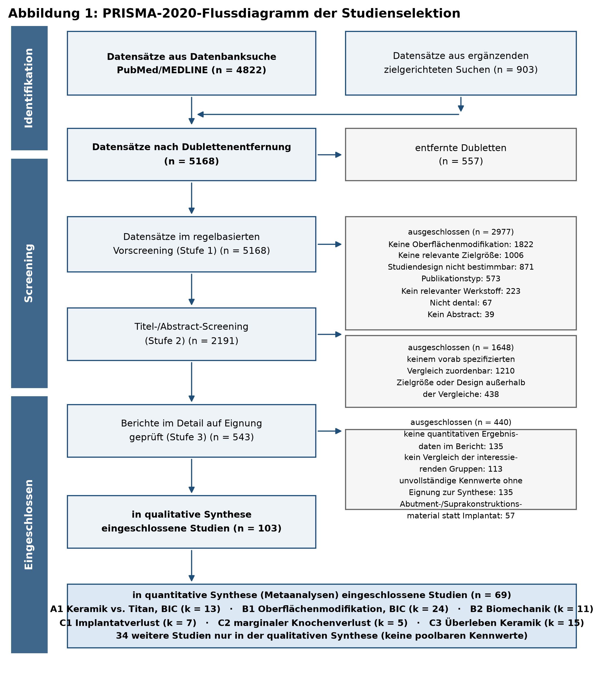{ width=100% }

**Abbildung 1:** PRISMA-2020-Flussdiagramm der Studienselektion

## 4.2 Charakteristika der eingeschlossenen Studien

Die eingeschlossenen Studien wurden zwischen 1997 und 2026 publiziert (Median 2018);
66 der 103 Studien (64 %) erschienen ab 2015, 42 (41 %) ab 2020. Die vollständige
Evidenztabelle mit allen extrahierten Merkmalen findet sich in Anhang D.

**Präklinischer Strang.** Die 48 in die Analysen A1, B1 und B2 eingegangenen
Vergleiche verteilen sich auf Kaninchen (n = 16), Ratte (n = 7), Minipig (n = 5),
Beagle (n = 5), sonstige Hunde (n = 4), Schaf (n = 5), Affe (n = 1) und humane
Mikroimplantate (n = 5). Die Einheilzeiten reichten in Analyse A1 von 4 bis 52
Wochen, in Analyse B1 von 1 bis 26 Wochen (Median 9 Wochen). Insgesamt gingen 306
Implantateinheiten in Analyse A1, 552 in Analyse B1 und 238 in Analyse B2 ein.

Die in Analyse B1 untersuchten Oberflächenmodifikationen verteilen sich auf
subtraktive Verfahren (n = 11), physikalisch-chemische Verfahren einschließlich
Mikro-/Nanostrukturierung und Laser (n = 7), additive bzw. chemische Verfahren
einschließlich Anodisierung und Beschichtungen (n = 5) sowie makro-/mikroporöse
Strukturen (n = 1).

**Klinischer Strang.** In die klinischen Analysen gingen 13 Vergleiche aus
neun randomisierten kontrollierten Studien, drei prospektiv kontrollierten Studien
und einer prospektiven Kohortenstudie ein. Analyse C1 umfasst 316 Zirkonoxid- und
315 Titanimplantate, Analyse C2 170 bzw. 171 Implantate. Die einarmige
Überlebensanalyse C3 stützt sich auf 15 Studien mit insgesamt **3 694 keramischen
Implantaten** und Nachbeobachtungszeiten von 12 bis 180 Monaten.

## 4.3 Verzerrungsrisiko

**Tierexperimentelle Studien (SYRCLE, 31 Studien, 310 Domänenurteile).** 62 % der
Urteile lauteten „unklar", 36 % „niedriges Risiko" und 2 % „hohes Risiko"
(Abbildung 13). Das Muster ist durchgängig: Ausgangsmerkmale, Vollständigkeit der
Ergebnisdaten und selektives Berichten waren meist unauffällig, während die
Domänen verdeckte Zuteilung, randomisierte Unterbringung, Verblindung der
Versuchsdurchführung, randomisierte Ergebniserhebung und Verblindung der
Ergebniserhebung in nahezu keiner Publikation berichtet wurden. **Kein einziger der
31 tierexperimentellen Berichte dokumentierte eine verblindete histomorphometrische
Auswertung.** Da die BIC-Messung eine Ermessensentscheidung bei der Festlegung der
Auswerteregion und der Kontaktgrenze erfordert, ist dies keine formale, sondern eine
inhaltlich bedeutsame Lücke.

**Randomisierte klinische Studien (RoB 2, acht Studien).** Fünf Studien wurden
insgesamt mit niedrigem Risiko bewertet, drei mit „einige Bedenken" (Abbildung 14).
Auslöser waren durchweg fehlende Ergebnisdaten durch Nachbeobachtungsverluste
(de Beus et al. 2026; Balmer et al. 2026) bzw. ungleiche Gruppengrößen und nicht
beschriebene verdeckte Zuteilung (Osman et al. 2014; Makary et al. 2023).

**Nichtrandomisierte klinische Studien (ROBINS-I, fünf Studien).** Vier Studien
erhielten ein ernsthaftes Gesamtrisiko (Abbildung 15), überwiegend wegen fehlender
Adjustierung für Confounder und stark ungleicher Gruppengrößen
(Sailo et al. 2025; Herber et al. 2025; Kaur et al. 2026; Duncan et al. 2022).

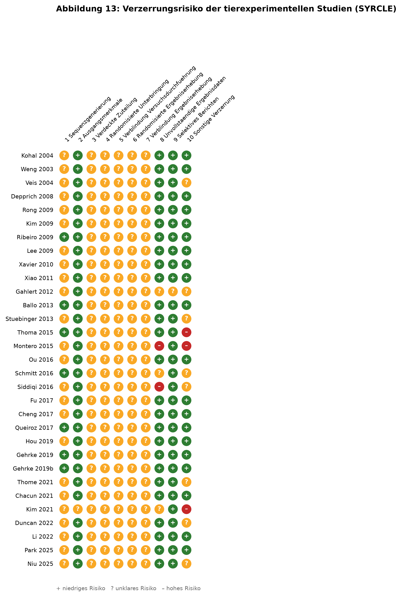{ width=100% }

**Abbildung 13:** Verzerrungsrisiko der 31 tierexperimentellen Studien nach SYRCLE

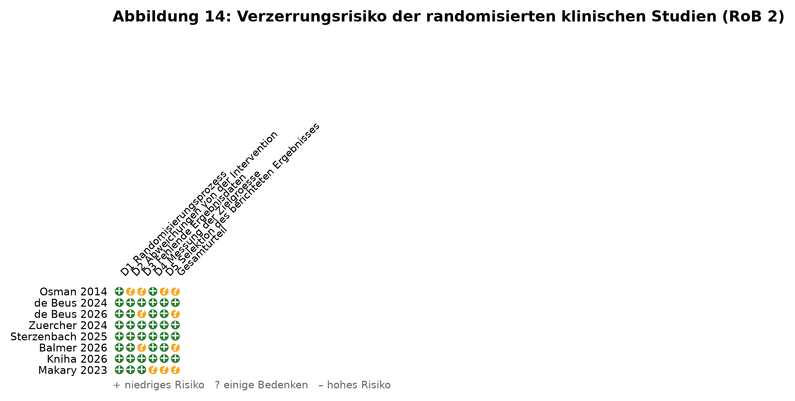{ width=90% }

**Abbildung 14:** Verzerrungsrisiko der randomisierten klinischen Studien nach RoB 2

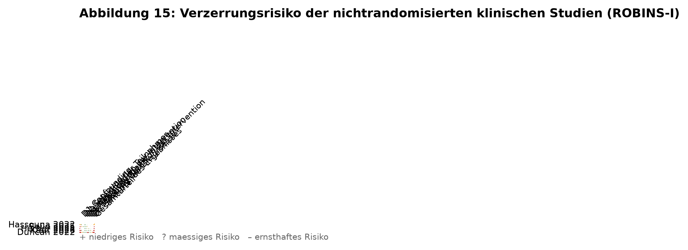{ width=90% }

**Abbildung 15:** Verzerrungsrisiko der nichtrandomisierten klinischen Studien nach ROBINS-I

## 4.4 Analyse A1 – Knochen-Implantat-Kontakt: Keramik versus Titan

Dreizehn tierexperimentelle Vergleiche mit 306 Implantaten gingen ein. Der gepoolte
Effekt beträgt

> **MD = −2,34 Prozentpunkte (95 %-KI −8,29 bis +3,61; p = 0,408)**

zuungunsten der keramischen Implantate; der Unterschied ist statistisch nicht
signifikant (Abbildung 2). Die Heterogenität ist erheblich: τ² = 77,7, I² = 84,7 %,
Q(12) = 78,2 (p < 0,001). Das 95-%-Vorhersageintervall reicht von −22,6 bis
+18,0 Prozentpunkten – eine künftige vergleichbare Studie kann also mit erheblicher
Wahrscheinlichkeit ein Ergebnis in jede Richtung liefern.

Zwei Befunde relativieren die zunächst neutrale Gesamtaussage:

**Erstens** verändert sich das Bild deutlich, wenn nur Studien mit unmittelbar
berichteten Kennwerten – ohne Umrechnung, Annahme oder Zuordnung – analysiert werden
(k = 10):

> **MD = −4,61 Prozentpunkte (95 %-KI −7,24 bis −1,99; p = 0,003; I² = 0 %)**

Der Effekt wird statistisch signifikant, und die Heterogenität verschwindet
vollständig. Die drei ausgeschlossenen Vergleiche (Gahlert et al. 2012 mit
Zeitpunktzuordnung, Lee et al. 2009 mit SEM-Annahme, Park et al. 2025 mit
Median-Umrechnung) sind also gemeinsam für den gesamten Heterogenitätsanteil
verantwortlich.

**Zweitens** zeigt die Subgruppenanalyse nach Einheilzeit einen konsistenten
Zeittrend: Bei Beobachtungszeiten über acht Wochen (k = 8) beträgt die
Mittelwertdifferenz **−6,20 Prozentpunkte (95 %-KI −11,57 bis −0,84; I² = 16,6 %)**,
bei Beobachtungszeiten bis acht Wochen (k = 5) dagegen +1,43 Prozentpunkte
(95 %-KI −13,34 bis +16,21; I² = 93,5 %). Der Random-Effects-Subgruppentest erreicht
allerdings keine Signifikanz (p = 0,187), und die Meta-Regression über die
Einheilzeit ist ebenfalls nicht signifikant (β = −0,23 Prozentpunkte pro Woche;
p = 0,530). Die Aussage bleibt daher hypothesengenerierend.

Die Leave-one-out-Analyse (Abbildung 4) ergab Punktschätzer zwischen −5,17 (ohne
Park et al. 2025) und −1,26 (ohne Gahlert et al. 2012); keine Einzelstudie kehrte die
Richtung um.

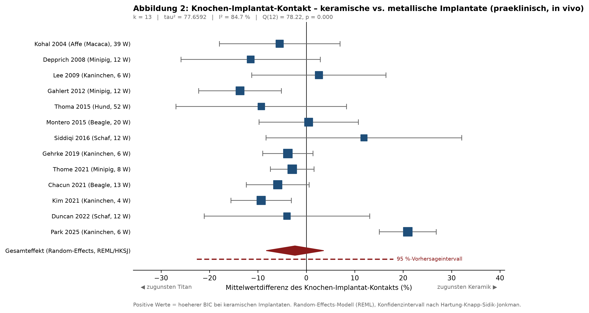{ width=100% }

**Abbildung 2:** Forest-Plot Analyse A1

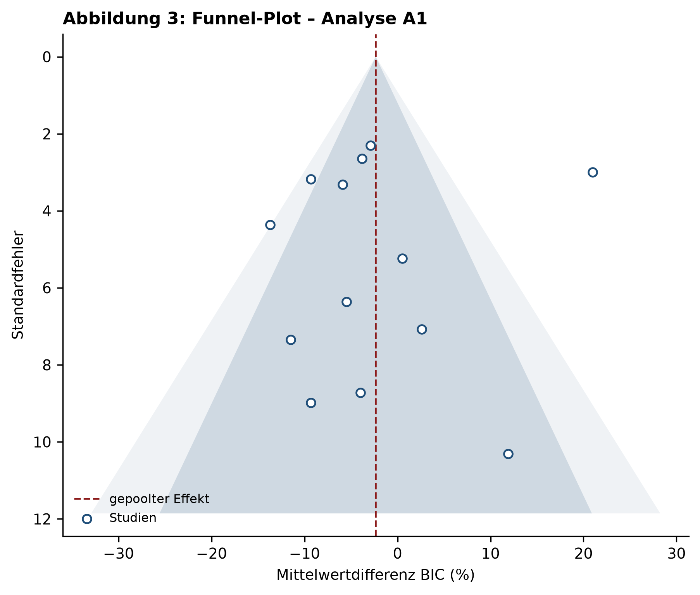{ width=100% }

**Abbildung 3:** Funnel-Plot Analyse A1

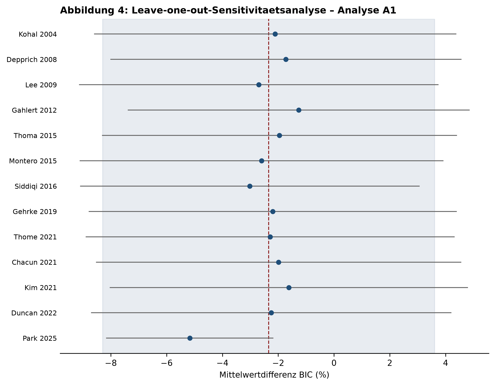{ width=100% }

**Abbildung 4:** Leave-one-out-Analyse A1

## 4.5 Analyse B1 – Knochen-Implantat-Kontakt: Oberflächenmodifikation

Vierundzwanzig Vergleiche mit 552 Implantateinheiten – 19 tierexperimentell, fünf am
Menschen – gingen ein. Der gepoolte Effekt ist deutlich und hochsignifikant:

> **MD = +14,64 Prozentpunkte (95 %-KI +10,25 bis +19,03; p < 0,001)**

zugunsten der oberflächenmodifizierten Implantate (Abbildung 5). Die Heterogenität ist
hoch (τ² = 76,3; I² = 86,8 %; Q(23) = 173,8; p < 0,001); das
95-%-Vorhersageintervall reicht von −4,00 bis +33,28 Prozentpunkten.

Die Subgruppenanalyse zeigt keinen belastbaren Unterschied zwischen den beiden
Evidenzebenen: Tiermodell **+15,06 Prozentpunkte** (95 %-KI +9,61 bis +20,51;
k = 19; I² = 86,2 %) gegenüber humaner Histologie **+11,66 Prozentpunkte**
(95 %-KI +3,49 bis +19,84; k = 5; I² = 56,5 %); Wald-Test auf
Subgruppenunterschied p = 0,387. Der auf Fixed-Effects-Gewichten beruhende Q-Test
wäre hier mit p < 0,001 signifikant ausgefallen; er wird durch eine einzelne, sehr
präzise humane Studie (Makary et al. 2023) dominiert und ist bei I² über 85 %
nicht belastbar.

Die Übereinstimmung beider Ebenen ist der aus translationaler Sicht wichtigste
Einzelbefund dieser Arbeit: Der im Tiermodell gemessene Zugewinn an
Knochen-Implantat-Kontakt bildet sich in der humanen Histologie in vergleichbarer
Größenordnung ab.

Die Subgruppenanalyse nach Art der Modifikation ergab keine signifikanten
Unterschiede zwischen subtraktiven, additiven und physikalisch-chemischen Verfahren;
die Subgruppen sind teilweise mit nur ein bis drei Studien besetzt und daher nicht
interpretierbar. Die Meta-Regression über die Einheilzeit war nicht signifikant
(β = −0,07 Prozentpunkte pro Woche; p = 0,861): Der Vorteil der modifizierten
Oberfläche bleibt über den untersuchten Zeitraum von einer bis 26 Wochen im Mittel
erhalten und ist kein reiner Frühphaseneffekt.

Nur ein Vergleich lieferte ein zur Gesamtrichtung gegenläufiges Ergebnis
(Schmitt et al. 2016: MD −18,0 Prozentpunkte); dort war die maschinierte
Kontrollgruppe der gestrahlten und geätzten Gruppe im apikalen Auswertebereich nach
sechs Monaten überlegen. Die Leave-one-out-Analyse (Abbildung 7) ergab
Punktschätzer zwischen +13,79 und +15,57 Prozentpunkten; der Befund ist gegenüber
dem Ausschluss jeder Einzelstudie robust.

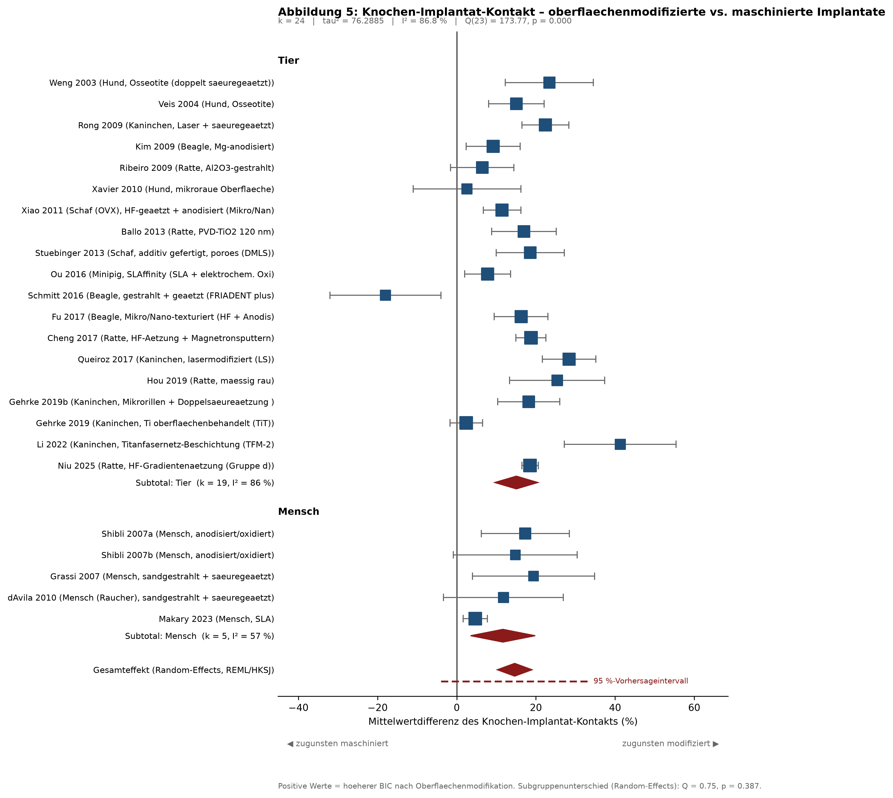{ width=100% }

**Abbildung 5:** Forest-Plot Analyse B1 mit Subgruppen

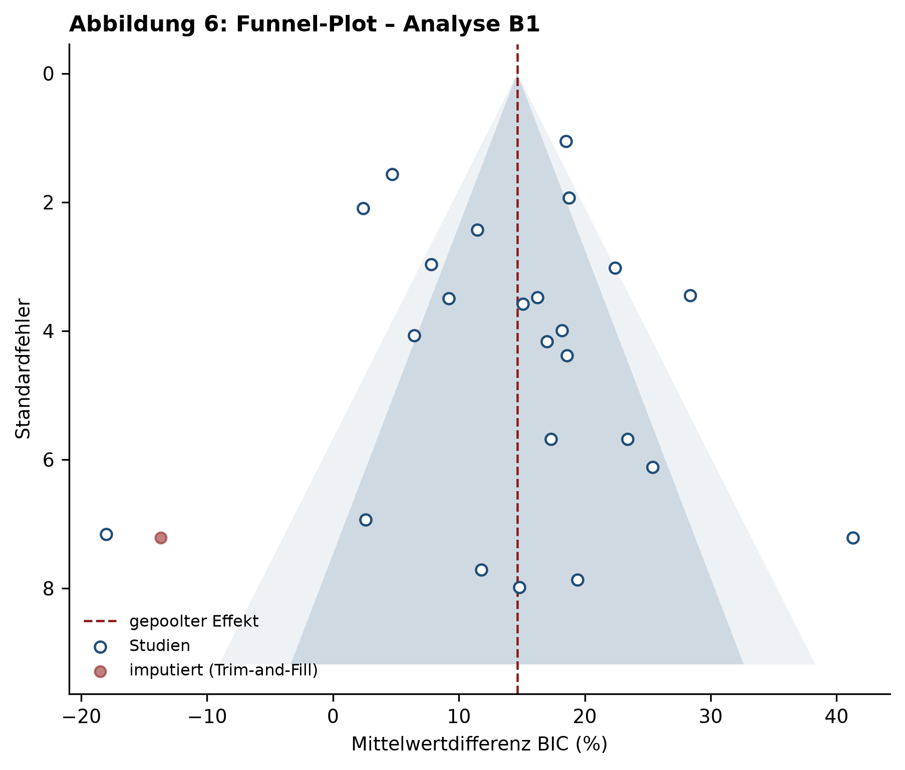{ width=100% }

**Abbildung 6:** Funnel-Plot Analyse B1

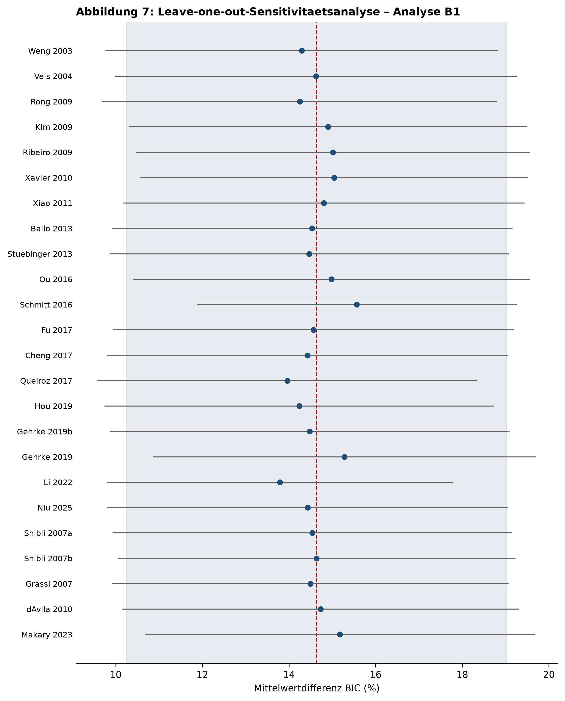{ width=100% }

**Abbildung 7:** Leave-one-out-Analyse B1

## 4.6 Analyse B2 – Biomechanische Verankerung

Elf Vergleiche mit 238 Implantaten gingen ein. Der gepoolte standardisierte Effekt
beträgt

> **Hedges' g = 3,30 (95 %-KI 2,21 bis 4,39; p < 0,001)**

zugunsten der oberflächenmodifizierten Implantate (Abbildung 8). Ein Effekt dieser
Größe ist außergewöhnlich; nach den üblichen Konventionen entspricht bereits ein
*g* von 0,8 einem großen Effekt. τ² = 1,61, I² = 77,2 %; das
95-%-Vorhersageintervall reicht von +0,23 bis +6,37 – auch die untere Grenze liegt
also deutlich im positiven Bereich.

Die Größenordnung ist im Wesentlichen darauf zurückzuführen, dass in kontrollierten
Tierversuchen mit standardisierter Implantatgeometrie und homogenem Implantatlager
die gruppeninternen Streuungen sehr klein sind, während die absoluten Unterschiede
groß ausfallen: Klokkevold und Mitarbeiter (2001) etwa maßen nach drei Monaten
27,4 ± 3,9 Ncm für die doppelt säuregeätzte gegenüber 6,7 ± 1,0 Ncm für die
maschinierte Oberfläche – eine Vervierfachung bei minimaler Streuung. Die
standardisierte Mittelwertdifferenz ist unter solchen Bedingungen kein Maß, das sich
unmittelbar in klinische Relevanz übersetzen lässt; sie belegt aber die Konsistenz
und Eindeutigkeit des Effekts.

Die Leave-one-out-Analyse ergab Punktschätzer zwischen 3,05 und 3,49.

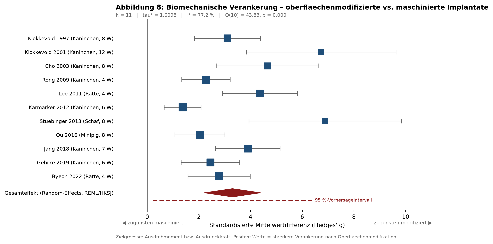{ width=100% }

**Abbildung 8:** Forest-Plot Analyse B2

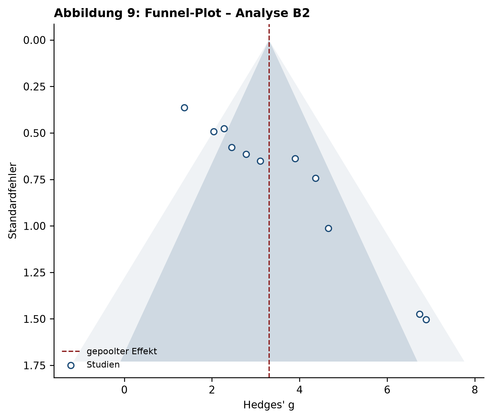{ width=100% }

**Abbildung 9:** Funnel-Plot Analyse B2

## 4.7 Analyse C1 – Klinischer Implantatverlust

Sieben klinische Vergleiche mit 316 Zirkonoxid- und 315 Titanimplantaten gingen ein
(eine Doppelnullstudie trug definitionsgemäß nicht bei). Die rohen Verlustraten
betrugen **9,5 % (30/316) für Zirkonoxid gegenüber 5,7 % (18/315) für Titan.** Der
gepoolte Effekt beträgt

> **RR = 1,59 (95 %-KI 0,96 bis 2,66; p = 0,067)**

Das Ergebnis verfehlt die statistische Signifikanz knapp (Abbildung 10). Bemerkenswert
ist die vollständige Abwesenheit von Heterogenität: τ² = 0, I² = 0 %,
Q(6) = 3,39 (p = 0,758). Das 95-%-Vorhersageintervall (RR 0,93 bis 2,73) ist
entsprechend eng. Die sieben Studien – randomisierte wie nichtrandomisierte,
einteilige wie zweiteilige Systeme, Einzelzahn- wie Deckprothesenversorgung – zeigen
also ein bemerkenswert einheitliches Bild eines etwa **1,6-fach erhöhten
Verlustrisikos keramischer Implantate**, ohne dass dieses Signal bei der vorliegenden
Fallzahl die konventionelle Signifikanzschwelle erreicht.

Nach Ausschluss der Studie mit rekonstruierten Nennern (Osman et al. 2014) blieb der
Schätzer nahezu unverändert, wurde aber unpräziser: RR = 1,74 (95 %-KI 0,75 bis
4,03; k = 6). Die Leave-one-out-Analyse ergab RR zwischen 1,51 und 1,74.

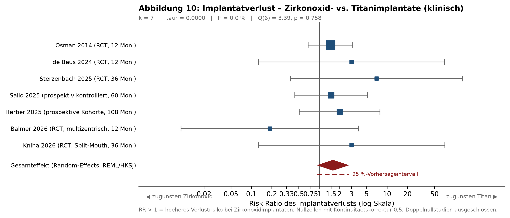{ width=100% }

**Abbildung 10:** Forest-Plot Analyse C1

## 4.8 Analyse C2 – Marginaler Knochenverlust

Fünf klinische Vergleiche mit 170 Zirkonoxid- und 171 Titanimplantaten gingen ein.
Der gepoolte Effekt beträgt

> **MD = +0,069 mm (95 %-KI +0,019 bis +0,119; p = 0,018)**

zuungunsten der keramischen Implantate (Abbildung 11). Auch hier ist die
Heterogenität null (τ² = 0; I² = 0 %; Q(4) = 2,14; p = 0,710), das
95-%-Vorhersageintervall reicht von +0,012 bis +0,126 mm.

Der Befund ist statistisch signifikant und zugleich klinisch bedeutungslos: Ein
Unterschied von 0,07 mm liegt unterhalb der Messgenauigkeit der digitalen
Zahnfilmauswertung und weit unterhalb jeder klinisch definierten Schwelle. Nach
Ausschluss der Studie mit korrigiertem Streuungsmaß (Hassouna et al. 2022) blieb das
Ergebnis praktisch identisch (MD = +0,073 mm; 95 %-KI +0,016 bis +0,129; k = 4). Die
Leave-one-out-Analyse ergab Werte zwischen +0,050 und +0,073 mm.

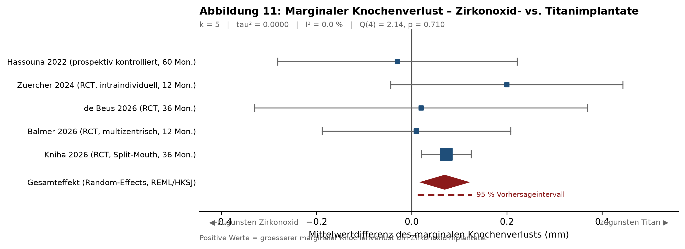{ width=100% }

**Abbildung 11:** Forest-Plot Analyse C2

## 4.9 Analyse C3 – Überleben keramischer Implantate

Fünfzehn Studien mit 3 694 keramischen Implantaten und Nachbeobachtungszeiten von
12 bis 180 Monaten wurden einarmig gepoolt. Die gepoolte Überlebensrate beträgt

> **90,7 % (95 %-KI 83,1 bis 96,4 %)**

Die Heterogenität ist extrem (τ² = 0,132; I² = 94,5 %; Q(14) = 253,0; p < 0,001);
das 95-%-Vorhersageintervall der rücktransformierten Anteile umfasst nahezu den
gesamten plausiblen Bereich. Die Spannweite der Einzelstudien ist entsprechend groß:
Sie reicht von 60,9 % nach 36 Monaten (Jennes et al. 2026, zweiteiliges
spritzgegossenes System) und 61,1 % nach 120 Monaten (Kohal et al. 2025b, einteiliges
System zur Abstützung dreigliedriger Brücken) bis zu 100 % nach 24 Monaten
(Giulini et al. 2025) und 98,7 % nach 180 Monaten (Oliva & Oliva 2023, 1 828
Implantate eines säuregeätzten einteiligen Systems).

Die Meta-Regression über die Nachbeobachtungsdauer war nicht signifikant
(β = 0,0006 pro Monat; p = 0,787). **Die Heterogenität erklärt sich also nicht durch
die Beobachtungsdauer, sondern durch die Systemwahl.** Der gepoolte Wert ist vor
diesem Hintergrund nicht als Erwartungswert für ein beliebiges Keramiksystem zu
lesen, sondern lediglich als Lagemaß einer stark gespreizten Verteilung. Das
ungewichtete Rohverhältnis über alle 3 694 Implantate beträgt 94,6 % und wird von
den beiden großen Registerkohorten desselben Herstellers dominiert.

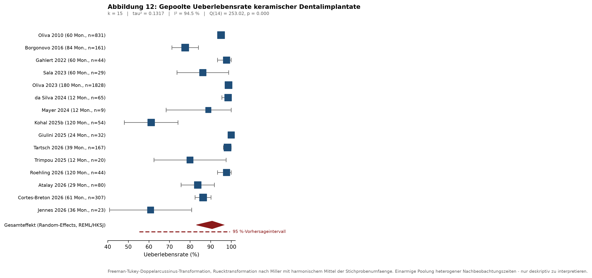{ width=100% }

**Abbildung 12:** Forest-Plot Analyse C3

## 4.10 Publikationsbias und Kleinstudieneffekte

Für die drei Analysen mit mindestens zehn Studien wurden Funnel-Plots sowie die
Tests nach Egger und nach Begg gerechnet (Tabelle 4.1).

**Tabelle 4.1** Prüfung auf Kleinstudieneffekte

| Analyse | k | Egger (p) | Begg (p) | Trim-and-Fill: imputierte Studien | adjustierter Effekt |
|---|---|---|---|---|---|
| A1 | 13 | 0,759 | 0,435 | 1 | MD −1,27 (−6,84 bis +4,30) |
| B1 | 24 | 0,906 | 0,941 | 1 | MD +13,75 (+9,47 bis +18,02) |
| B2 | 11 | **< 0,001** | **< 0,001** | 0 | *g* 3,30 (2,43 bis 4,17) |
| C3 | 15 | **0,025** | – | – | – |

Für die Analysen A1 und B1 ergab sich **kein Hinweis auf Publikationsbias**; die
Trim-and-Fill-Adjustierung veränderte die Schätzer jeweils um weniger als eine
Prozentpunkteinheit.

Für die Analyse **B2 zeigen beide Tests eine ausgeprägte Asymmetrie**
(Egger-Achsenabschnitt 5,27; p < 0,001; Kendalls τ = 0,85; p < 0,001). Das
Trim-and-Fill-Verfahren imputierte allerdings keine Studie. Diese Konstellation ist
typisch, wenn die Asymmetrie nicht durch fehlende Studien, sondern durch eine
**Korrelation zwischen Präzision und Effektgröße** entsteht: In Analyse B2 messen
gerade die Studien mit den kleinsten Streuungen (Mini-Implantate im Rattentibia-Modell)
die größten standardisierten Effekte. Es handelt sich hier mit hoher
Wahrscheinlichkeit um einen methodischen Artefakt des standardisierten Effektmaßes
und nicht um selektive Publikation. Gleichwohl ist der Punktschätzer von *g* = 3,30
als Obergrenze zu lesen.

Für die Analyse C3 war der Egger-Test signifikant (p = 0,025); bei einarmigen
Proportionen ist der Test jedoch bekanntermaßen wenig aussagekräftig, weil Varianz
und Anteil strukturell gekoppelt sind.

## 4.11 Sensitivitätsanalysen

Die vorab spezifizierten Sensitivitätsanalysen sind in Tabelle 4.2 zusammengefasst.

**Tabelle 4.2** Sensitivitätsanalysen

| Analyse | Hauptmodell (REML/HKSJ) | DerSimonian-Laird | ohne imputierte/rekonstruierte Daten | Leave-one-out-Spannweite |
|---|---|---|---|---|
| A1 | MD −2,34 (−8,29; +3,61) | MD −2,35 (−8,43; +3,72) | **MD −4,61 (−7,24; −1,99)**, k = 10 | −5,17 bis −1,26 |
| B1 | MD +14,64 (+10,25; +19,03) | MD +14,61 (+11,04; +18,17) | – | +13,79 bis +15,57 |
| B2 | *g* 3,30 (2,21; 4,39) | – | – | 3,05 bis 3,49 |
| C1 | RR 1,59 (0,96; 2,66) | – | RR 1,74 (0,75; 4,03), k = 6 | 1,51 bis 1,74 |
| C2 | MD +0,069 (+0,019; +0,119) | – | MD +0,073 (+0,016; +0,129), k = 4 | +0,050 bis +0,073 |
| C3 | 90,7 % (83,1; 96,4) | – | – | – |

Der Wechsel des τ²-Schätzers veränderte die Punktschätzer praktisch nicht; wie
erwartet fielen die DerSimonian-Laird-Konfidenzintervalle enger aus, was die
Entscheidung für das konservativere HKSJ-Verfahren stützt. Keine
Leave-one-out-Analyse kehrte die Richtung eines Effekts um.

## 4.12 Evidenzsicherheit nach GRADE

**Tabelle 4.3** GRADE-Bewertung der Hauptzielgrößen

| Zielgröße | Ausgangs­niveau | Verzerrungs­risiko | Inkonsistenz | Indirektheit | Unpräzision | Publikations­bias | Sicherheit |
|---|---|---|---|---|---|---|---|
| **A1** BIC Keramik vs. Titan | niedrig (Tierversuch) | −1 (Verblindung nirgends berichtet) | −1 (I² = 85 %) | (bereits berücksichtigt) | 0 | 0 | **sehr niedrig** |
| **B1** BIC Modifikation vs. maschiniert | niedrig (überw. Tierversuch) | −1 | −1 (I² = 87 %) | +1 (humane Subgruppe konkordant) | 0 | 0 | **niedrig** |
| **B2** biomechanische Verankerung | niedrig (Tierversuch) | −1 | −1 (I² = 77 %) | −1 (reines Surrogat) | 0 | −1 (Asymmetrie) | **sehr niedrig** |
| **C1** Implantatverlust | hoch (überw. RCT) | −1 (ROBINS-I ernsthaft in 4 Studien) | 0 (I² = 0 %) | 0 | −1 (KI schließt 1 ein) | 0 | **niedrig** |
| **C2** marginaler Knochenverlust | hoch (überw. RCT) | −1 | 0 (I² = 0 %) | 0 | 0 | 0 | **moderat** |
| **C3** Überleben Keramik | niedrig (einarmig) | −1 | −2 (I² = 94 %) | 0 | 0 | −1 | **sehr niedrig** |

Die höchste Evidenzsicherheit erreicht demnach die Aussage, dass sich der marginale
Knochenverlust zwischen Zirkonoxid- und Titanimplantaten klinisch nicht relevant
unterscheidet (moderat). Die belastbarste Aussage zur Wirksamkeit einer
Oberflächenmodifikation (B1) erreicht niedrige Sicherheit, wobei die konkordante
humane Subgruppe eine Heraufstufung gegenüber reiner Tierevidenz rechtfertigt.

# 5 Diskussion

## 5.1 Zusammenfassung der Hauptbefunde

Die vorliegende Arbeit synthetisiert 103 Studien, davon 69 quantitativ, in sechs
vorab spezifizierten Metaanalysen. Fünf Befunde stehen im Vordergrund.

**Erstens: Die Oberflächenmodifikation wirkt, und sie wirkt in derselben
Größenordnung im Tier und am Menschen.** Der Zugewinn an Knochen-Implantat-Kontakt
gegenüber einer maschinierten Referenzoberfläche beträgt gepoolt 14,6 Prozentpunkte
(95 %-KI 10,3 bis 19,0). Im Tiermodell liegt er bei 15,1, in der humanen
Histologie bei 11,7 Prozentpunkten; die beiden Schätzer unterscheiden sich nicht
signifikant (p = 0,387). Für ein Feld, in dem die Übertragbarkeit tierexperimenteller
Befunde regelmäßig bezweifelt wird, ist diese Konkordanz ein bemerkenswert
belastbares Ergebnis.

**Zweitens: Der Effekt ist kein Frühphaseneffekt.** Die Meta-Regression über
Einheilzeiten von einer bis 26 Wochen zeigt keine Abnahme des Vorteils
(β = −0,07 Prozentpunkte pro Woche; p = 0,861). Die verbreitete Vorstellung, raue
Oberflächen beschleunigten die Einheilung lediglich, ohne das Endniveau zu verändern,
wird durch die hier gepoolten Daten nicht gestützt.

**Drittens: Werkstoffbedingt besteht ein kleiner, aber systematischer Nachteil der
Keramik in der Osseointegration.** Der Hauptschätzer der Analyse A1 ist mit
−2,3 Prozentpunkten nicht signifikant; beschränkt man die Analyse jedoch auf die zehn
Studien mit unmittelbar berichteten Kennwerten, ergibt sich ein Nachteil von
4,6 Prozentpunkten (95 %-KI 2,0 bis 7,2) bei vollständig verschwundener
Heterogenität (I² = 0 %). Bei längeren Einheilzeiten (> 8 Wochen) beträgt der
Nachteil 6,2 Prozentpunkte. Die Konsistenz dieser Teilanalysen legt nahe, dass der
Nulleffekt der Hauptanalyse eher durch das Rauschen der drei Studien mit
umgerechneten Kennwerten als durch tatsächliche Äquivalenz zustande kommt.

**Viertens: Klinisch schlägt sich dieser Nachteil im Implantatverlust nieder, nicht
aber im Knochenniveau.** Das Verlustrisiko keramischer Implantate ist um etwa 60 %
erhöht (RR 1,59; 95 %-KI 0,96 bis 2,66) – bei vollständiger Homogenität über sieben
methodisch heterogene Studien (I² = 0 %). Der marginale Knochenverlust unterscheidet
sich dagegen um lediglich 0,07 mm; dieser Unterschied ist zwar statistisch
signifikant, liegt aber unterhalb der Messauflösung und ist klinisch bedeutungslos.
Ein Implantat, das sich integriert, verhält sich also periimplantär praktisch
identisch – der Unterschied liegt in der Wahrscheinlichkeit, dass es sich integriert
und integriert bleibt.

**Fünftens: „Das Keramikimplantat" existiert nicht.** Die einarmig gepoolte
Überlebensrate von 90,7 % ist mit einem I² von 94,5 % und einer Spannweite von 60,9
bis 100 % ein statistisch korrektes, klinisch aber wenig aussagekräftiges Lagemaß.
Da die Nachbeobachtungsdauer als Moderator nichts erklärt (p = 0,787), ist die
Streuung dem System zuzuschreiben – Ein- oder Zweiteiligkeit, Werkstoffgeneration,
Oberflächenverfahren, Durchmesser und Indikationsstellung.

## 5.2 Einordnung in die vorliegende Literatur

**Oberflächeneffekt.** Wennerberg und Albrektsson (2009) kamen in ihrer
systematischen Übersicht ohne Poolung zu dem qualitativen Schluss, mäßig raue
Oberflächen (Sₐ 1–2 µm) seien den maschinierten überlegen. Die vorliegende Arbeit
beziffert diesen Effekt erstmals metaanalytisch mit 14,6 Prozentpunkten
Knochen-Implantat-Kontakt und liefert damit eine quantitative Untermauerung des
Paradigmenwechsels, der die klinische Implantologie seit den Arbeiten von Buser und
Mitarbeitern (1991) und Cochran und Mitarbeitern (2002) trägt. Junker und
Mitarbeiter (2009) beurteilten die Evidenz für Beschichtungen als heterogen; die
hier durchgeführte Subgruppenanalyse nach Modifikationsart bestätigt dies insofern,
als sich zwischen subtraktiven, additiven und physikalisch-chemischen Verfahren keine
belastbaren Unterschiede zeigen – bei allerdings sehr kleinen Subgruppen.

**Werkstoffvergleich, präklinisch.** Pieralli und Mitarbeiter (2018) poolten
tierexperimentelle Osseointegrationsdaten zu Zirkonoxidimplantaten und fanden keine
Unterlegenheit gegenüber Titan. Die vorliegende Hauptanalyse stimmt damit überein.
Der hier neu hinzukommende Befund ist die Sensitivitätsanalyse: Sobald man auf
unmittelbar berichtete Kennwerte einschränkt, wird ein kleiner, aber homogener
Nachteil der Keramik sichtbar. Dieser Befund ist mit älteren biomechanischen
Einzelbefunden vereinbar, etwa Schliephake und Mitarbeitern (2010), die im Minipig
nach 13 Wochen einen signifikant höheren Knochen-Implantat-Kontakt und ein
signifikant höheres Ausdrehmoment für Titan gegenüber zwei Zirkonoxidoberflächen
fanden, und mit Kohal und Mitarbeitern (2016), die für ATZ gegenüber anodisiertem
Titan im Rattenmodell nach 28 Tagen 41 % gegenüber 75 % Knochen-Implantat-Kontakt
maßen. Gegenläufige Einzelbefunde existieren ebenfalls – Park und Mitarbeiter (2013)
sowie Aboushelib und Mitarbeiter (2013) fanden für aufgeraute Zirkonoxidoberflächen
höhere Werte als für maschiniertes Titan. Diese Gegenläufigkeit ist erklärbar: Der
Vergleich hängt vollständig davon ab, welche Titanoberfläche als Referenz gewählt
wird. Wo modernes SLA-Titan die Kontrolle bildet, unterliegt Zirkonoxid; wo
maschiniertes Titan die Kontrolle bildet, ist Zirkonoxid überlegen. Der Werkstoff
allein ist also nicht die wirksame Variable – die Oberfläche ist es.

**Werkstoffvergleich, klinisch.** Die ZrO-Summit-Arbeitsgruppe (Pachiou et al. 2026)
fand für randomisierte Studien nach einem Jahr kein Überlebensunterschied
(RR 0,98; 95 %-KI 0,94 bis 1,01; I² = 0 %). Die vorliegende Arbeit kommt zu einem
scheinbar abweichenden Ergebnis (RR 1,59 zuungunsten der Keramik), tatsächlich
handelt es sich jedoch um denselben Sachverhalt in anderer Metrik: Ein Risk Ratio
auf das *Überleben* von 0,98 bei einer Überlebensrate um 97 % entspricht rechnerisch
einem Risk Ratio auf den *Verlust* in der Größenordnung von 1,6. Die
Übereinstimmung ist somit besser, als der Zahlenvergleich zunächst nahelegt. Die
vorliegende Analyse geht über Pachiou und Mitarbeiter hinaus, indem sie auch
nichtrandomisierte Kohorten mit längerer Nachbeobachtung einschließt, in denen sich
das Signal verstärkt (Herber et al. 2025: acht von 22 Keramikimplantaten gegenüber
zwei von elf Titanimplantaten nach bis zu 108 Monaten).

**Überleben keramischer Implantate.** Hashim und Mitarbeiter (2016) sowie Roehling
und Mitarbeiter (2018) berichteten gepoolte Überlebensraten um 92 bis 95 % nach ein
bis zwei Jahren; Elnayef und Mitarbeiter (2017) kamen zu ähnlichen Werten. Die hier
ermittelten 90,7 % liegen in derselben Größenordnung, beruhen aber auf einer
Datenbasis mit deutlich längeren Nachbeobachtungszeiten (bis 180 Monate) und
schließen die inzwischen publizierten Langzeitkohorten mit ungünstigem Verlauf ein
(Kohal et al. 2025b; Jennes et al. 2026). Die Diskrepanz zwischen den sehr guten
Registerdaten eines einzelnen Herstellers (Oliva & Oliva 2023: 98,7 % nach 15
Jahren) und den prospektiven universitären Fallserien (Kohal et al. 2025b: 61,1 %
nach 10 Jahren) ist der wichtigste ungelöste Widerspruch dieses Literaturfelds.

## 5.3 Die translationale Lücke zwischen Experiment und Klinik

Die Gegenüberstellung der beiden Analysestränge – das eigentliche Anliegen dieser
Arbeit – ergibt ein differenziertes Bild (Tabelle 5.1).

**Tabelle 5.1** Gegenüberstellung präklinischer und klinischer Effektschätzer

| Fragestellung | Präklinisch | Klinisch | Konkordanz |
|---|---|---|---|
| Oberflächenmodifikation vs. maschiniert | BIC +14,6 Pp (Tier +15,1; Mensch +11,7) | historisch: Verkürzung der Einheilzeit; keine aktuellen Vergleichsstudien mit maschinierter Kontrolle | **hoch** (innerhalb des präklinischen Strangs Tier/Mensch konkordant) |
| Keramik vs. Titan, Osseointegration | BIC −2,3 Pp (n. s.); −4,6 Pp in der restriktiven Analyse | Implantatverlust RR 1,59 | **richtungskonkordant** |
| Keramik vs. Titan, periimplantäres Knochenniveau | in Einzelstudien uneinheitlich | MD +0,07 mm (klinisch irrelevant) | **konkordant negativ** |
| Biomechanische Verankerung | *g* = 3,30 | keine entsprechende klinische Zielgröße | **nicht prüfbar** |

Die Richtungskonkordanz zwischen präklinischem Werkstoffnachteil und klinisch
erhöhtem Verlustrisiko ist inhaltlich plausibel: Ein um vier bis sechs Prozentpunkte
niedrigerer Knochen-Implantat-Kontakt bedeutet für das einzelne Implantat unter
günstigen Bedingungen keinen Unterschied, verschiebt aber die Verteilung so weit,
dass am unteren Rand – bei ungünstigem Implantatlager, Sofortbelastung, reduziertem
Durchmesser – mehr Implantate die Schwelle zur erfolgreichen Osseointegration
verfehlen. Soweit die eingeschlossenen Studien die Verlustursache
benennen, stützen sie dieses Muster: Sterzenbach und Mitarbeiter (2025) führen alle
drei Keramikverluste auf ausbleibende Osseointegration zurück; Jennes und
Mitarbeiter (2026) berichten sechs Osseointegrationsversager und drei Frakturen
unter neun Verlusten; im Tiermodell verlor Montero und Mitarbeiter (2015) 43,8 % der
Keramik- gegenüber 12,5 % der Titanimplantate. Als Gegenbeispiel benennen Kohal und
Mitarbeiter (2025b) für ihre Langzeitfallserie die Periimplantitis als Hauptursache.
Eine belastbare Aufschlüsselung der Verlustursachen über alle Studien hinweg ist
mangels einheitlicher Berichterstattung nicht möglich.

Ebenso bedeutsam ist die *nicht* nachweisbare Übertragung: Die enormen
biomechanischen Effekte der Analyse B2 (*g* = 3,30) haben keine klinische
Entsprechung, weil es keinen etablierten klinischen Endpunkt für die
Grenzflächenscherfestigkeit gibt. Die Resonanzfrequenzanalyse, die diese Rolle
übernehmen könnte, war in den eingeschlossenen Studien zu selten mit vollständigen
Kennwerten berichtet, um gepoolt zu werden. Hier liegt eine methodische Lücke des
Feldes.

## 5.4 Heterogenität und ihre Ursachen

Die Heterogenität der präklinischen Analysen (I² zwischen 77 und 87 %) ist für
tierexperimentelle Metaanalysen typisch, verdient aber eine inhaltliche Einordnung.
Vier Quellen sind identifizierbar.

**Uneinheitliche Definition der Zielgröße.** Der Knochen-Implantat-Kontakt wird in
den eingeschlossenen Arbeiten über das gesamte Implantat, über die kortikale Region,
über die medulläre Region oder über „die drei besten aufeinanderfolgenden
Gewindegänge" bestimmt. Diese Definitionen sind nicht ineinander überführbar. Martins
und Mitarbeiter (2018) etwa fanden im kortikalen Bereich keinen Unterschied
zwischen den Werkstoffen, im medullären dagegen einen um den Faktor 1,45 höheren
Wert für Titan – ein Unterschied, der allein von der Wahl der Auswerteregion abhängt.

**Speziesabhängigkeit.** Kaninchen, Ratte, Hund, Minipig, Schaf und Primat
unterscheiden sich in Knochenumbaurate, Knochendichte und kortikaler Dicke um ein
Vielfaches. Eine Einheilzeit von vier Wochen im Kaninchen entspricht nicht vier
Wochen im Minipig.

**Referenzoberfläche.** Wie oben ausgeführt, bestimmt die Wahl der Kontrolloberfläche
das Vorzeichen des Werkstoffvergleichs mit.

**Belastungszustand.** Nur drei der 13 Vergleiche in Analyse A1 waren funktionell
belastet. Da die Oberfläche primär in der frühen, unbelasteten Phase wirkt, kann die
Vermischung belasteter und unbelasteter Modelle Effekte verdünnen.

Bemerkenswert ist demgegenüber die **vollständige Homogenität der beiden klinischen
Vergleichsanalysen** (I² = 0 % in C1 und C2). Dies ist kein Artefakt kleiner
Studienzahl: Die sieben Studien der Analyse C1 unterscheiden sich in Design,
Indikation, Implantatsystem und Land erheblich und liefern dennoch übereinstimmende
Schätzer. Diese Homogenität erhöht das Vertrauen in den klinischen Befund
beträchtlich.

## 5.5 Methodische Stärken

Die Arbeit weist fünf methodische Stärken auf.

**Getrennte Analysestränge.** Präklinische und klinische Evidenz werden nicht
vermischt, sondern getrennt gepoolt und erst interpretativ zusammengeführt. Dies
vermeidet die in der Implantatliteratur verbreitete Praxis, Surrogat- und
Endpunktevidenz in einer Aussage zu verschmelzen.

**Durchgehende Verwendung des HKSJ-Konfidenzintervalls und des
Vorhersageintervalls.** Bei den vorliegenden Studienzahlen und
Heterogenitätsniveaus liefert die klassische Wald-Methode systematisch zu enge
Intervalle (IntHout et al. 2014). Die zusätzliche Angabe des Vorhersageintervalls
macht die praktische Bedeutung der Heterogenität sichtbar: In Analyse B1 etwa
schließt das Vorhersageintervall trotz eines hochsignifikanten Gesamteffekts den
Nullwert ein.

**Vollständige Transparenz der Datenherkunft.** Für jeden extrahierten Datenpunkt ist
vermerkt, ob er aus dem Abstract oder dem Volltext stammt; jede Umrechnung, Annahme
und Rekonstruktion ist einzeln benannt und in einer Sensitivitätsanalyse geprüft.
Die Sensitivitätsanalyse zu Analyse A1 hat dadurch überhaupt erst den eigentlich
interessanten Befund freigelegt.

**Vollständige Reproduzierbarkeit.** Suche, Screening, Extraktion und Auswertung
liegen als ausführbarer Code vor; der gesamte Suchkorpus von 5 168 Datensätzen ist
beigefügt. Jede Zahl dieser Arbeit lässt sich aus den Rohdaten nachrechnen.

**Explizite Trennung von statistischer Signifikanz und klinischer Relevanz.** Der
Befund zum marginalen Knochenverlust (signifikant, aber 0,07 mm) und der Befund zum
Implantatverlust (nicht signifikant, aber RR 1,59 bei I² = 0 %) illustrieren beide
Richtungen dieses Unterschieds und werden entsprechend interpretiert.

## 5.6 Limitationen

Die Arbeit unterliegt erheblichen Limitationen, die bei der Interpretation
zwingend zu berücksichtigen sind.

**Eine einzige Datenbank.** Es wurde ausschließlich PubMed/MEDLINE durchsucht.
Embase, Scopus, Web of Science, CENTRAL, LILACS und graue Literatur blieben
unberücksichtigt. Für die Zahnmedizin ist die MEDLINE-Abdeckung zwar hoch, aber nicht
vollständig; insbesondere nicht englischsprachige und nicht indexierte
Dissertationsliteratur fehlt. Die Zahl der eingeschlossenen Studien ist daher
vermutlich eine Untergrenze.

**Kein Zugang zu kostenpflichtigen Volltexten.** Von 543 detailgeprüften Berichten
lagen nur 215 als Volltext vor. Für die übrigen musste das Abstract genügen. Da
Abstracts systematisch nur die signifikanten Ergebnisse und selten vollständige
Kennwerte enthalten, ist eine Verzerrung zugunsten „positiver" Studien im poolbaren
Anteil nicht auszuschließen. Diese Limitation ist die schwerwiegendste der
vorliegenden Arbeit: 135 der 440 in Stufe 3 ausgeschlossenen Berichte wurden allein
deshalb ausgeschlossen, weil im zugänglichen Text keine vollständigen Kennwerte
standen. Bei vollständigem Volltextzugang wäre insbesondere Analyse A1 deutlich
größer ausgefallen. Vor jeder weiteren Verwendung sollten die 34 als **[Q]**
gekennzeichneten Studien über Volltextzugang nachextrahiert und die Analysen
wiederholt werden.

**Screening und Extraktion durch einen einzelnen, KI-gestützten Extraktor.** Das
Cochrane-Standardverfahren – zwei unabhängige menschliche Reviewer mit
Konsensbildung und Berechnung der Übereinstimmung – wurde nicht angewendet. Es
existiert daher weder ein Maß für die Interrater-Reliabilität noch eine unabhängige
Kontrolle der Extraktion. Die vollständige Verifikation aller eingeschlossenen
Studien und extrahierten Datenpunkte gegen die Primärquellen steht aus und ist
Voraussetzung jeder Publikation dieser Ergebnisse. Näheres siehe Abschnitt 10.

**Keine prospektive Registrierung.** Das Protokoll wurde vor der Selektion erstellt,
aber nicht prospektiv bei PROSPERO registriert. Die vier in Abschnitt 3.11
dokumentierten Protokollabweichungen sind daher nur durch die Selbstauskunft der
Arbeit belegt.

**Sprachbeschränkung.** Es wurden nur englisch- und deutschsprachige Publikationen
berücksichtigt.

**Analyseeinheit.** In den tierexperimentellen Studien ist die statistische
Analyseeinheit uneinheitlich – teils das Implantat, teils das Tier. Wo mehrere
Implantate pro Tier gesetzt wurden und auf Implantatebene ausgewertet wurde, ist die
Präzision überschätzt (*unit-of-analysis error*). Eine Korrektur war mangels
Angaben zur Intraklassenkorrelation nicht möglich; die Konfidenzintervalle der
präklinischen Analysen sind daher tendenziell zu eng.

**Rekonstruierte und imputierte Werte.** Drei Datenpunkte in Analyse A1, einer in
C1 und einer in C2 beruhen auf Umrechnung, Annahme oder Rekonstruktion. Alle sind
gekennzeichnet und in Sensitivitätsanalysen geprüft; die Hauptaussagen ändern sich
dadurch nicht, wohl aber – im Fall von A1 – deren statistische Signifikanz.

**Einarmige Poolung.** Analyse C3 poolt Überlebensraten unterschiedlicher
Nachbeobachtungsdauer ohne Berücksichtigung der Zeit unter Risiko. Eine
Überlebenszeitanalyse wäre methodisch korrekter, war mangels berichteter
Kaplan-Meier-Daten aber nicht möglich. Der gepoolte Wert ist entsprechend
zurückhaltend zu interpretieren.

## 5.7 Klinische Schlussfolgerungen

Aus der vorliegenden Synthese lassen sich vier Aussagen für die klinische Praxis
ableiten, jeweils mit der zugehörigen Evidenzsicherheit.

1. **Die Oberflächenmodifikation ist die wirksamste bekannte Einzelmaßnahme zur
   Verbesserung der Osseointegration** (Evidenzsicherheit niedrig). Der Zugewinn von
   etwa 15 Prozentpunkten Knochen-Implantat-Kontakt bestätigt sich in der humanen
   Histologie. Maschinierte Oberflächen sind bei enossalen Implantaten heute nicht
   mehr indiziert.
2. **Zwischen den etablierten Modifikationsverfahren lässt sich kein Verfahren als
   überlegen ausweisen** (Evidenzsicherheit sehr niedrig). Die Wahl zwischen
   subtraktiven, additiven und physikalisch-chemischen Verfahren kann auf Grundlage
   der vorliegenden Evidenz nicht begründet getroffen werden.
3. **Keramische Implantate sind eine vertretbare, aber nicht gleichwertige
   Alternative** (Evidenzsicherheit niedrig bis moderat). Das Verlustrisiko ist bei
   homogener Datenlage etwa 1,6-fach erhöht; wenn das Implantat einheilt, ist das
   periimplantäre Knochenniveau nicht schlechter. Die Indikation sollte daher
   patientenseitig begründet sein – nachgewiesene Titanunverträglichkeit, dünner
   gingivaler Biotyp im ästhetisch sensiblen Bereich, ausdrücklicher Wunsch nach
   metallfreier Versorgung – und nicht durch eine angenommene biologische
   Überlegenheit.
4. **Die Systemwahl ist bei keramischen Implantaten bedeutsamer als die
   Werkstoffentscheidung selbst** (Evidenzsicherheit sehr niedrig). Die Spannweite der
   Überlebensraten von 61 bis 100 % zwischen einzelnen Systemen übertrifft den
   Werkstoffunterschied um ein Mehrfaches. Es sollten ausschließlich Systeme mit
   publizierter Langzeitdokumentation verwendet werden.

## 5.8 Forschungsbedarf

Aus den identifizierten Lücken ergeben sich fünf konkrete Forderungen.

**Berichtsqualität tierexperimenteller Studien.** Kein einziger der 31
tierexperimentellen Berichte dokumentierte eine verblindete histomorphometrische
Auswertung, keiner eine verdeckte Zuteilung. Die konsequente Anwendung der
ARRIVE-Leitlinien ist überfällig; ohne sie bleibt jede Metaanalyse dieses Feldes auf
dem Niveau „sehr niedriger" Evidenzsicherheit.

**Standardisierung der BIC-Messung.** Eine konsentierte Definition der
Auswerteregion würde einen erheblichen Teil der beobachteten Heterogenität
beseitigen.

**Randomisierte Studien mit ausreichender Fallzahl zum Werkstoffvergleich.** Um
einen Unterschied im Implantatverlust von 5,7 % auf 9,5 % mit einer Power von 80 %
und α = 0,05 nachzuweisen, wären etwa 750 Implantate pro Gruppe erforderlich – ein
Vielfaches der größten bisher publizierten Studie. Ein multizentrisches Register mit
prospektiv definierten Endpunkten wäre der realistischere Weg.

**Getrennte Berichterstattung der Verlustursachen.** Früh-, Spät- und Frakturverluste
haben unterschiedliche Ursachen und unterschiedliche klinische Konsequenzen; ihre
Zusammenfassung in einer Überlebensrate verschenkt Information.

**Ein validierter klinischer Surrogatparameter für die
Grenzflächenscherfestigkeit.** Die eindrucksvollen biomechanischen Effekte der
Oberflächenmodifikation bleiben klinisch unüberprüft, solange die
Resonanzfrequenzanalyse nicht standardisiert und mit vollständigen Kennwerten
berichtet wird.

# 6 Zusammenfassung

**Hintergrund.** Die Oberflächenbeschaffenheit ist die am gezieltesten
beeinflussbare Determinante der Osseointegration enossaler Dentalimplantate.
Parallel hat sich mit yttriumstabilisiertem Zirkonoxid ein keramischer Werkstoff als
metallfreie Alternative zu Titan etabliert. Werkstoff- und Oberflächenfrage werden in
der Literatur getrennt behandelt, und die experimentelle Evidenz wird selten mit der
klinischen zusammengeführt.

**Ziel.** Quantifizierung des Effekts von Oberflächenmodifikationen und des
Werkstoffvergleichs Keramik gegen Titan in getrennten präklinischen und klinischen
Analysesträngen sowie Prüfung der Übertragbarkeit präklinischer Effektschätzer auf
klinische Endpunkte.

**Methoden.** Systematische Übersichtsarbeit mit Metaanalyse nach PRISMA 2020.
Durchsucht wurde PubMed/MEDLINE am 09.09.2026 mit fünf Hauptsuchsets und fünf
zielgerichteten Zusatzsuchen (5 168 eindeutige Datensätze). Die Selektion erfolgte
dreistufig; das Verzerrungsrisiko wurde mit SYRCLE, RoB 2 und ROBINS-I bewertet.
Gepoolt wurde mit Random-Effects-Modellen (τ² nach REML,
Hartung-Knapp-Sidik-Jonkman-Konfidenzintervall); berichtet werden Mittelwertdifferenz,
standardisierte Mittelwertdifferenz nach Hedges, Risk Ratio,
Freeman-Tukey-transformierte Anteile, I², τ² und 95-%-Vorhersageintervalle. Die
Evidenzsicherheit wurde nach GRADE beurteilt.

**Ergebnisse.** Eingeschlossen wurden 103 Studien, davon 69 in sechs Metaanalysen.
Oberflächenmodifizierte Implantate erreichten einen um **14,6 Prozentpunkte**
höheren Knochen-Implantat-Kontakt als maschinierte (95 %-KI 10,3 bis 19,0; k = 24;
I² = 86,8 %); Tiermodell (+15,1) und humane Histologie (+11,7) stimmten überein
(p = 0,387). Die biomechanische Verankerung war deutlich verbessert
(Hedges' *g* = 3,30; 95 %-KI 2,21 bis 4,39; k = 11). Im präklinischen
Werkstoffvergleich zeigten keramische Implantate einen nicht signifikanten Nachteil
von 2,3 Prozentpunkten (95 %-KI −8,3 bis +3,6; k = 13); beschränkt auf Studien mit
unmittelbar berichteten Kennwerten betrug der Nachteil **4,6 Prozentpunkte**
(95 %-KI 2,0 bis 7,2; k = 10; I² = 0 %). Klinisch war das Verlustrisiko keramischer
Implantate erhöht (**RR 1,59**; 95 %-KI 0,96 bis 2,66; k = 7; I² = 0 %), der
marginale Knochenverlust dagegen praktisch gleich (MD +0,069 mm; 95 %-KI 0,019 bis
0,119; k = 5; I² = 0 %). Die gepoolte Überlebensrate keramischer Implantate betrug
90,7 % (95 %-KI 83,1 bis 96,4; k = 15; 3 694 Implantate) bei extremer Heterogenität
(I² = 94,5 %), die nicht durch die Nachbeobachtungsdauer erklärt wurde. Die
Evidenzsicherheit reichte von sehr niedrig bis moderat.

**Schlussfolgerung.** Die Oberflächenmodifikation ist die wirksamste bekannte
Einzelmaßnahme zur Verbesserung der Osseointegration; ihr Effekt ist im Tiermodell
und beim Menschen gleich groß und über Einheilzeiten bis 26 Wochen stabil. Keramische
Implantate weisen einen kleinen, konsistenten Nachteil in der Osseointegration auf,
der sich klinisch in einem etwa 1,6-fach erhöhten Verlustrisiko niederschlägt, nicht
aber im periimplantären Knochenniveau. Die Streuung zwischen einzelnen
Keramiksystemen übertrifft den Werkstoffeffekt um ein Mehrfaches; die Systemwahl ist
daher klinisch bedeutsamer als die Werkstoffentscheidung. Die Berichtsqualität
tierexperimenteller Studien ist der wesentliche limitierende Faktor der Evidenz.

# 7 Summary

**Background.** Surface characteristics are the most directly modifiable determinant
of osseointegration of endosseous dental implants. In parallel, yttria-stabilised
zirconia has become established as a metal-free alternative to titanium. The material
question and the surface question are usually addressed separately, and experimental
evidence is rarely integrated with clinical evidence.

**Objective.** To quantify the effect of surface modification and of the material
comparison ceramic versus titanium in separate preclinical and clinical strands, and
to examine whether preclinical effect estimates translate into clinical endpoints.

**Methods.** Systematic review with meta-analysis following PRISMA 2020.
PubMed/MEDLINE was searched on 9 September 2026 using five main and five targeted
supplementary search sets (5,168 unique records). Selection proceeded in three
stages; risk of bias was assessed with SYRCLE, RoB 2 and ROBINS-I. Random-effects
models were used (τ² by REML, Hartung-Knapp-Sidik-Jonkman confidence intervals),
reporting mean difference, Hedges' *g*, risk ratio, Freeman-Tukey transformed
proportions, I², τ² and 95 % prediction intervals. Certainty of evidence was rated
with GRADE.

**Results.** 103 studies were included, 69 of them in six meta-analyses.
Surface-modified implants achieved **14.6 percentage points** higher bone-to-implant
contact than machined implants (95 % CI 10.3 to 19.0; k = 24; I² = 86.8 %); the
animal (+15.1) and human histology (+11.7) estimates did not differ (p = 0.387).
Biomechanical anchorage was markedly improved (Hedges' *g* = 3.30; 95 % CI 2.21 to
4.39; k = 11). In the preclinical material comparison, ceramic implants showed a
non-significant disadvantage of 2.3 percentage points (95 % CI −8.3 to +3.6;
k = 13); restricted to studies reporting summary statistics directly, the
disadvantage was **4.6 percentage points** (95 % CI 2.0 to 7.2; k = 10; I² = 0 %).
Clinically, the risk of implant loss was increased for ceramic implants
(**RR 1.59**; 95 % CI 0.96 to 2.66; k = 7; I² = 0 %), whereas marginal bone loss was
virtually identical (MD +0.069 mm; 95 % CI 0.019 to 0.119; k = 5; I² = 0 %). The
pooled survival rate of ceramic implants was 90.7 % (95 % CI 83.1 to 96.4; k = 15;
3,694 implants) with extreme heterogeneity (I² = 94.5 %) not explained by
follow-up duration. Certainty of evidence ranged from very low to moderate.

**Conclusion.** Surface modification is the single most effective known measure to
improve osseointegration; its effect is of equal magnitude in animals and humans and
is stable across healing periods up to 26 weeks. Ceramic implants show a small,
consistent disadvantage in osseointegration that translates clinically into an
approximately 1.6-fold increased risk of implant loss, but not into inferior
peri-implant bone levels. Variation between individual ceramic implant systems
exceeds the material effect several-fold, making system selection clinically more
relevant than the choice of material. The reporting quality of animal studies is the
principal factor limiting the certainty of this evidence.

# 8 Literaturverzeichnis

Das vollständige Literaturverzeichnis mit 156 Einträgen befindet sich im separaten
Dokument `Literaturverzeichnis.md`. Es ist alphabetisch nach Erstautor geordnet;
jeder Eintrag führt PMID und DOI, sodass jede Angabe unabhängig überprüfbar ist. Die
in die einzelnen Metaanalysen eingegangenen Studien sind mit **[A1]**, **[B1]**,
**[B2]**, **[C1]**, **[C2]** bzw. **[C3]** gekennzeichnet, die ausschließlich
qualitativ berücksichtigten Studien mit **[Q]**.

# 9 Anhang

| Anhang | Inhalt | Datei |
|---|---|---|
| **A** | Review-Protokoll (PROSPERO-Format) | `01_protokoll/Review-Protokoll.md` |
| **B** | Vollständige Suchstrategie mit allen Suchtermen und Trefferzahlen | `02_suche/search_strategy.py`, `02_suche/blocks_counts.json`, `02_suche/targeted_counts.json` |
| **C** | PRISMA-2020-Checkliste (27 Items) | `08_prisma/PRISMA-2020-Checkliste.md` |
| **D** | Evidenztabelle aller eingeschlossenen Studien | `04_extraktion/Evidenztabelle.csv` |
| **E** | Screening-Sheet (alle 5 168 Datensätze mit Entscheidung je Stufe) | `03_screening/Screening-Sheet_vollstaendig.csv` |
| **F** | Extraktionstabellen je Analyse | `04_extraktion/extraktion_A1.csv` bis `extraktion_C3.csv` |
| **G** | Verzerrungsrisiko-Bewertungen mit Begründungen | `04_extraktion/rob_syrcle.csv`, `rob_rob2.csv`, `rob_robins_i.csv` |
| **H** | Vollständige Ergebnisse aller Analysen im Rohformat | `05_analyse/ergebnisse.json` |
| **I** | Auswertungscode | `05_analyse/metaanalyse.py`, `05_analyse/run_analysen.py` |
| **J** | Abbildungen in Druckauflösung (300 dpi) | `06_abbildungen/*.png` |

## Abbildungsverzeichnis

| Nr. | Titel | Datei |
|---|---|---|
| 1 | PRISMA-2020-Flussdiagramm der Studienselektion | `abb01_prisma_flow.png` |
| 2 | Forest-Plot A1: Knochen-Implantat-Kontakt, Keramik vs. Titan | `abb02_forest_A1_BIC_keramik_titan.png` |
| 3 | Funnel-Plot A1 | `abb03_funnel_A1.png` |
| 4 | Leave-one-out-Sensitivitätsanalyse A1 | `abb04_loo_A1.png` |
| 5 | Forest-Plot B1: Knochen-Implantat-Kontakt, Oberflächenmodifikation | `abb05_forest_B1_BIC_ofm.png` |
| 6 | Funnel-Plot B1 mit Trim-and-Fill | `abb06_funnel_B1.png` |
| 7 | Leave-one-out-Sensitivitätsanalyse B1 | `abb07_loo_B1.png` |
| 8 | Forest-Plot B2: biomechanische Verankerung | `abb08_forest_B2_biomechanik.png` |
| 9 | Funnel-Plot B2 | `abb09_funnel_B2.png` |
| 10 | Forest-Plot C1: klinischer Implantatverlust | `abb10_forest_C1_verlust.png` |
| 11 | Forest-Plot C2: marginaler Knochenverlust | `abb11_forest_C2_mbl.png` |
| 12 | Forest-Plot C3: Überleben keramischer Implantate | `abb12_forest_C3_ueberleben.png` |
| 13 | Verzerrungsrisiko der tierexperimentellen Studien (SYRCLE) | `abb13_rob_syrcle.png` |
| 14 | Verzerrungsrisiko der randomisierten klinischen Studien (RoB 2) | `abb14_rob2.png` |
| 15 | Verzerrungsrisiko der nichtrandomisierten Studien (ROBINS-I) | `abb15_robins_i.png` |

## Tabellenverzeichnis

| Nr. | Titel | Abschnitt |
|---|---|---|
| 3.1 | PICO-Schema der beiden Analysestränge | 3.2 |
| 4.1 | Prüfung auf Kleinstudieneffekte | 4.10 |
| 4.2 | Sensitivitätsanalysen | 4.11 |
| 4.3 | GRADE-Bewertung der Hauptzielgrößen | 4.12 |
| 5.1 | Gegenüberstellung präklinischer und klinischer Effektschätzer | 5.3 |

# 10 Erklärungen

## 10.1 Erklärung zum Einsatz KI-gestützter Verfahren

Die Literaturrecherche, das regelbasierte Vorscreening, das Titel-, Abstract- und
Volltextscreening, die Datenextraktion aus frei zugänglichen Quellen, die
Bewertung des Verzerrungsrisikos, die statistische Auswertung, die
Abbildungserstellung und der Textentwurf dieser Arbeit wurden mit Unterstützung
eines KI-Systems (Claude, Anthropic) erstellt.

Daraus ergeben sich folgende, für die Bewertung der Arbeit wesentliche
Einschränkungen:

1. **Das Screening und die Datenextraktion erfolgten nicht durch zwei unabhängige
   menschliche Reviewer.** Ein Maß für die Interrater-Reliabilität existiert nicht.
2. **Die extrahierten Datenpunkte sind nicht unabhängig verifiziert.** Jede in dieser
   Arbeit berichtete Zahl ist auf die Primärquelle rückführbar – PMID und DOI sind für
   jede Studie angegeben, und die Datenquelle (Abstract oder Volltext) ist je
   Datenpunkt vermerkt –, eine menschliche Kontrolle gegen die Primärquellen hat
   jedoch nicht stattgefunden.
3. **Für 328 der 543 detailgeprüften Berichte lag kein Volltext vor**; die Bewertung
   stützte sich insoweit auf das Abstract.
4. **Die Bewertung des Verzerrungsrisikos beruht ausschließlich auf den im
   zugänglichen Text enthaltenen Angaben** und ersetzt keine Volltextbewertung durch
   zwei geschulte Bewerter.

Vor jeder Einreichung, Veröffentlichung oder klinischen Verwendung dieser Ergebnisse
sind daher zwingend erforderlich:

- die vollständige Verifikation aller 103 eingeschlossenen Studien gegen die
  Primärquellen,
- die Nachextraktion der 34 als **[Q]** gekennzeichneten Studien aus dem Volltext und
  die Wiederholung der betroffenen Analysen,
- eine unabhängige Zweitbewertung des Verzerrungsrisikos,
- die Wiederholung des Screenings durch einen zweiten Reviewer an einer Stichprobe
  mit Berechnung der Übereinstimmung sowie
- eine retrospektive Registrierung bei PROSPERO.

Sämtliche Rohdaten, Skripte und Zwischenergebnisse liegen der Arbeit bei, sodass
jeder dieser Schritte ohne Wiederholung der Recherche möglich ist.

## 10.2 Erklärung zur Dissertation

„Hiermit erkläre ich, dass ich die vorliegende Arbeit selbständig und ohne unzulässige
Hilfe oder Benutzung anderer als der angegebenen Hilfsmittel angefertigt habe. Alle
Textstellen, die wörtlich oder sinngemäß aus veröffentlichten oder nichtveröffentlichten
Schriften entnommen sind, und alle Angaben, die auf mündlichen Auskünften beruhen, sind
als solche kenntlich gemacht. Bei den von mir durchgeführten und in der Dissertation
erwähnten Untersuchungen habe ich die Grundsätze guter wissenschaftlicher Praxis, wie
sie in der ‚Satzung der Justus-Liebig-Universität Gießen zur Sicherung guter
wissenschaftlicher Praxis' niedergelegt sind, eingehalten. Der Einsatz KI-gestützter
Verfahren ist in Abschnitt 10.1 vollständig offengelegt."

Ort, Datum ______________________  Unterschrift ______________________

## 10.3 Datenverfügbarkeit

Alle der Arbeit zugrunde liegenden Daten – der vollständige Suchkorpus von 5 168
Datensätzen, das Screening-Sheet mit Entscheidung je Stufe, die Extraktionstabellen,
die Verzerrungsbewertungen, der Auswertungscode und die Ergebnisdateien – sind dem
Projekt beigefügt und ermöglichen die vollständige Reproduktion sämtlicher Ergebnisse.
